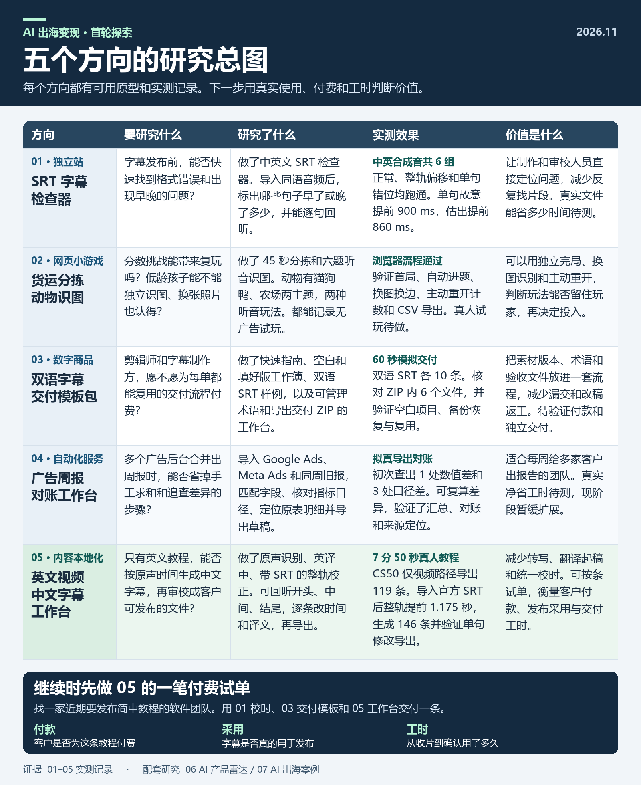

# GitHub 项目研究

记录值得深入研究的 GitHub 项目和可复用的产品探索，整理研究问题、实现方式与验证结果。每个子项目有独立的研究记录，可附截图与 Web 演示。

[打开研究库线上目录](https://yydshly.github.io/1123_codex_project/)

## 项目索引

| 编号 | 研究项目 | 摘要 | 预览 | Web 演示 |
| --- | --- | --- | --- | --- |
| 001 | [Motion2MixamoRig](projects/001-motion2mixamorig/README.md) | 从单人视频提取动作，或从全身照片估计姿势，再将动作或姿势迁移到可更换的已绑定 3D 角色。一次提取可让多个角色复用同一段表演，便于短片换机位、跨镜头衔接和制作可编辑的动画初稿。 | [引导图](#motion2mixamorig-引导图) | 未部署 |
| 002 | [AI 出海变现五方向](projects/002-ai-overseas-revenue/README.md) | 用可操作的原型验证独立站、网页小游戏、数字商品、自动化服务和内容本地化。对我们最直接的积累是可复用的字幕质检、翻译审校和交付流程，可用一单检验客户付款、发布采用和交付工时。 | [引导图](#ai-出海变现引导图) | [在线总览与原型](https://yydshly.github.io/1123_codex_project/002-ai-overseas-revenue/) · [本机运行](projects/002-ai-overseas-revenue/README.md#本机打开网页) |
| 003 | [AI 控制 Blender 的四轮建模工作流](projects/003-blender-workflow/README.md) | 让 AI 通过 Python 控制 Blender，按灰模、倒角、材质、灯光四轮逼近建模目标。每轮用同机位预览和检查数值定位偏差，定点修改并重渲复验，还能复用场景批量出变体。 | [引导图](#blender-四轮建模引导图) | 未部署 |
| 004 | [七个工具的价值与实践成果](projects/004-ai-tool-entry-lab/README.md) | 覆盖资料研读、联网查源、在线课程、翻译与术语、图像编辑、数学可视化和视频试镜。用论文、角色素材和扫描动画展示怎样保存可查的出处、可改的素材与可复算的结果，附两套 Word 与 Excel 校对原型。 | [引导图](#七个工具研究引导图) | [在线手册与演示](https://yydshly.github.io/1123_codex_project/004-ai-tool-entry-lab/) |
| 005 | [从 Next Token Skill 到 GEO](projects/005-geo-discovery-guide/README.md) | 从播客 RSS 和本地检索入手，用 AI 视频角色一致性实测练习跨站查证。再把方法用于 SEO 与 GEO，研究怎样发布可抓取、可引用的证据，让还不知道产品名的人也有机会按需求找到它，并用无品牌词问题验证效果。 | [引导图](#搜索seo-与-geo-引导图) | [在线指南](https://yydshly.github.io/1123_codex_project/005-geo-discovery-guide/) |

## Motion2MixamoRig 引导图

图中用同一场走廊戏对比两条制作路线。想让角色按照指定节奏停步、回头，并在转身过程中换机位时，可以把一次真人表演保留为 3D 骨骼动画。只需一个能讲清剧情的镜头时，可以直接生成视频。 [研究详情](projects/001-motion2mixamorig/README.md) · [高清 PNG](projects/001-motion2mixamorig/images/motion2mixamorig-guide.png)

## AI 出海变现引导图

逐项对照五个方向的研究问题、原型实测和用户价值。优先用内容本地化做一笔真实试单，记录客户是否付款、字幕是否用于发布及交付总工时。 [子项目详情](projects/002-ai-overseas-revenue/README.md) · [高清 PNG](projects/002-ai-overseas-revenue/research-overview.png)

## Blender 四轮建模引导图

左侧用原创桌面剪辑控制器展示灰模修正、倒角、材质、终稿与配色变体，右侧整理了可直接交给 AI 的执行和验收规则。 [研究详情](projects/003-blender-workflow/README.md) · [高清 PNG](projects/003-blender-workflow/images/blender-workflow-skill-card.png)

## 七个工具研究引导图

一张图对照工具价值、已做出的效果和项目里能留下的资产。底部展示参考图两版、同公式两站实测和无书签论文校对。 [研究详情](projects/004-ai-tool-entry-lab/README.md) · [在线成果汇总](https://yydshly.github.io/1123_codex_project/004-ai-tool-entry-lab/#summary)

## 搜索、SEO 与 GEO 引导图

从查找现有实测到发布自己的证据，沿同一个角色一致性问题看清 SEO 和 GEO 各自的作用。图中也标出 Skill 或能力对应的产品扩展。 [研究详情](projects/005-geo-discovery-guide/README.md) · [在线指南](https://yydshly.github.io/1123_codex_project/005-geo-discovery-guide/) · [高清 PNG](projects/005-geo-discovery-guide/web/seo-geo-overview.png)

## 收录约定

1. 按收录顺序从 `001` 开始编号，目录命名为 `projects/001-project-name/`。新增项目使用下一个编号，已分配的编号保留。
2. 复制[子项目模板](projects/_template/README.md)到新目录，记录原仓库、研究基线、核心发现和验证过程。演示源码可放在子项目的 `web/` 目录。
3. 在索引中按编号追加一行，链接到子项目 README，用一两句话说明研究重点。索引可放一张代表图，完整截图放在子项目的 `images/` 目录，在 README 为图片添加替代文字和图注。

## Web 演示

各演示共用 GitHub Pages 站点，按编号划分子路径。首页维护在 `docs/index.html`。`python scripts/build_pages.py` 将 002、004 和 005 的网页及所需素材组装到 `_site/`。提交到 `main` 后，由 Pages 工作流发布。

002 的音频对齐、广告周报计算和视频识别翻译在各自的 Python 服务上运行。线上总览附实测记录与本机启动说明。 [本机运行](projects/002-ai-overseas-revenue/README.md#本机打开网页) · [GitHub Pages 自定义工作流](https://docs.github.com/en/pages/getting-started-with-github-pages/using-custom-workflows-with-github-pages)
