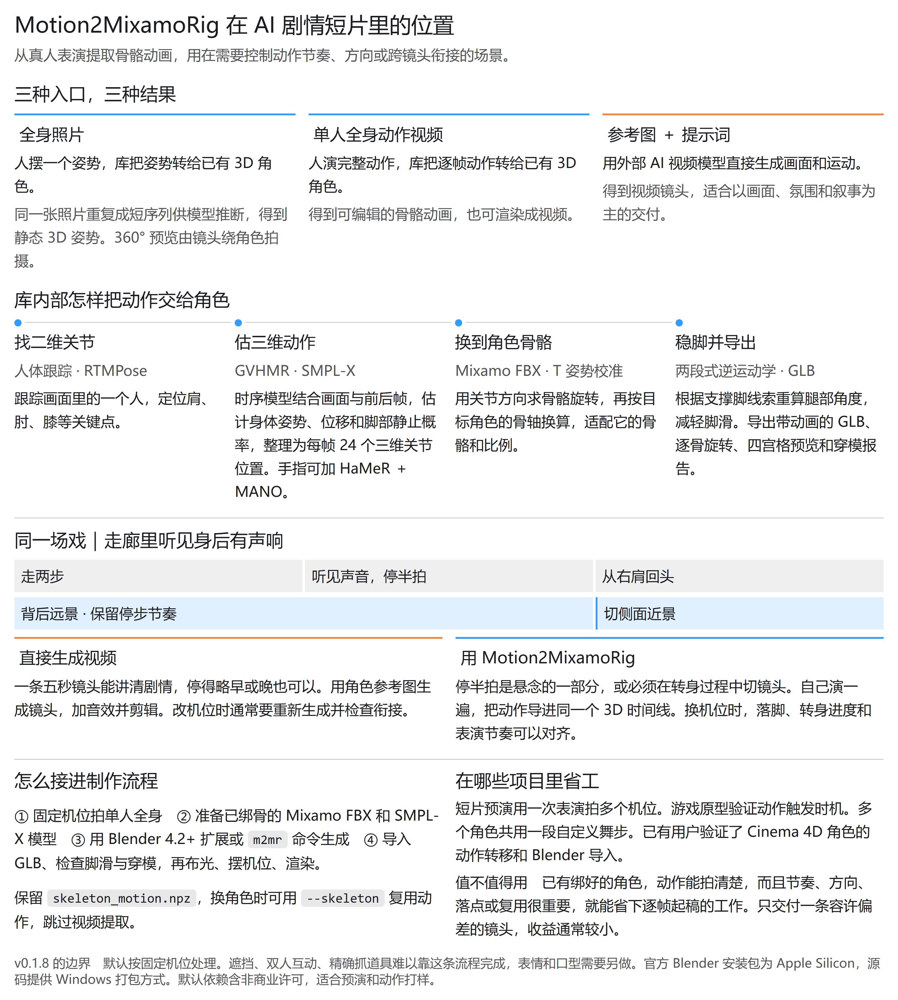

# GitHub 项目研究

记录值得深入研究的 GitHub 项目和可复用的产品探索，整理研究问题、实现方式与验证结果。每个子项目有独立的研究记录，可附截图与 Web 演示。

[打开研究库线上目录](https://yydshly.github.io/1123_codex_project/)

## 项目索引

| 编号 | 研究项目 | 摘要 | 预览 | Web 演示 |
| --- | --- | --- | --- | --- |
| 001 | [Motion2MixamoRig](projects/001-motion2mixamorig/README.md) | 从单人视频提取动作，或从全身照片估计姿势，再将动作或姿势迁移到可更换的已绑定 3D 角色。一次提取可让多个角色复用同一段表演，便于短片换机位、跨镜头衔接和制作可编辑的动画初稿。 | [引导图](#motion2mixamorig-引导图) | 未部署 |
| 002 | [AI 出海变现五方向](projects/002-ai-overseas-revenue/README.md) | 用可操作的原型验证独立站、网页小游戏、数字商品、自动化服务和内容本地化。对我们最直接的积累是可复用的字幕质检、翻译审校和交付流程，可用一单检验客户付款、发布采用和交付工时。 | [引导图](#ai-出海变现引导图) | [在线总览与原型](https://yydshly.github.io/1123_codex_project/002-ai-overseas-revenue/) · [本机运行](projects/002-ai-overseas-revenue/README.md#本机打开网页) |

## Motion2MixamoRig 引导图

图中用同一场走廊戏对比两条制作路线。想让角色按照指定节奏停步、回头，并在转身过程中换机位时，可以把一次真人表演保留为 3D 骨骼动画。只需一个能讲清剧情的镜头时，可以直接生成视频。 [研究详情](projects/001-motion2mixamorig/README.md) · [高清 PNG](projects/001-motion2mixamorig/images/motion2mixamorig-guide.png)

## AI 出海变现引导图

逐项对照五个方向的研究问题、原型实测和用户价值。优先用内容本地化做一笔真实试单，记录客户是否付款、字幕是否用于发布及交付总工时。 [子项目详情](projects/002-ai-overseas-revenue/README.md) · [高清 PNG](projects/002-ai-overseas-revenue/research-overview.png)

## 收录约定

1. 按收录顺序从 `001` 开始编号，目录命名为 `projects/001-project-name/`。新增项目使用下一个编号，已分配的编号保留。
2. 复制[子项目模板](projects/_template/README.md)到新目录，记录原仓库、研究基线、核心发现和验证过程。演示源码可放在子项目的 `web/` 目录。
3. 在索引中按编号追加一行，链接到子项目 README，用一两句话说明研究重点。索引可放一张代表图，完整截图放在子项目的 `images/` 目录，在 README 为图片添加替代文字和图注。

## Web 演示

各演示共用 GitHub Pages 站点，按编号划分子路径。首页维护在 `docs/index.html`。`python scripts/build_pages.py` 将 002 中可在线运行的页面和所需素材组装到 `_site/`。合并到 `main` 后，由 Pages 工作流发布。

002 的音频对齐、广告周报计算和视频识别翻译在各自的 Python 服务上运行。线上总览附实测记录与本机启动说明。 [本机运行](projects/002-ai-overseas-revenue/README.md#本机打开网页) · [GitHub Pages 自定义工作流](https://docs.github.com/en/pages/getting-started-with-github-pages/using-custom-workflows-with-github-pages)
