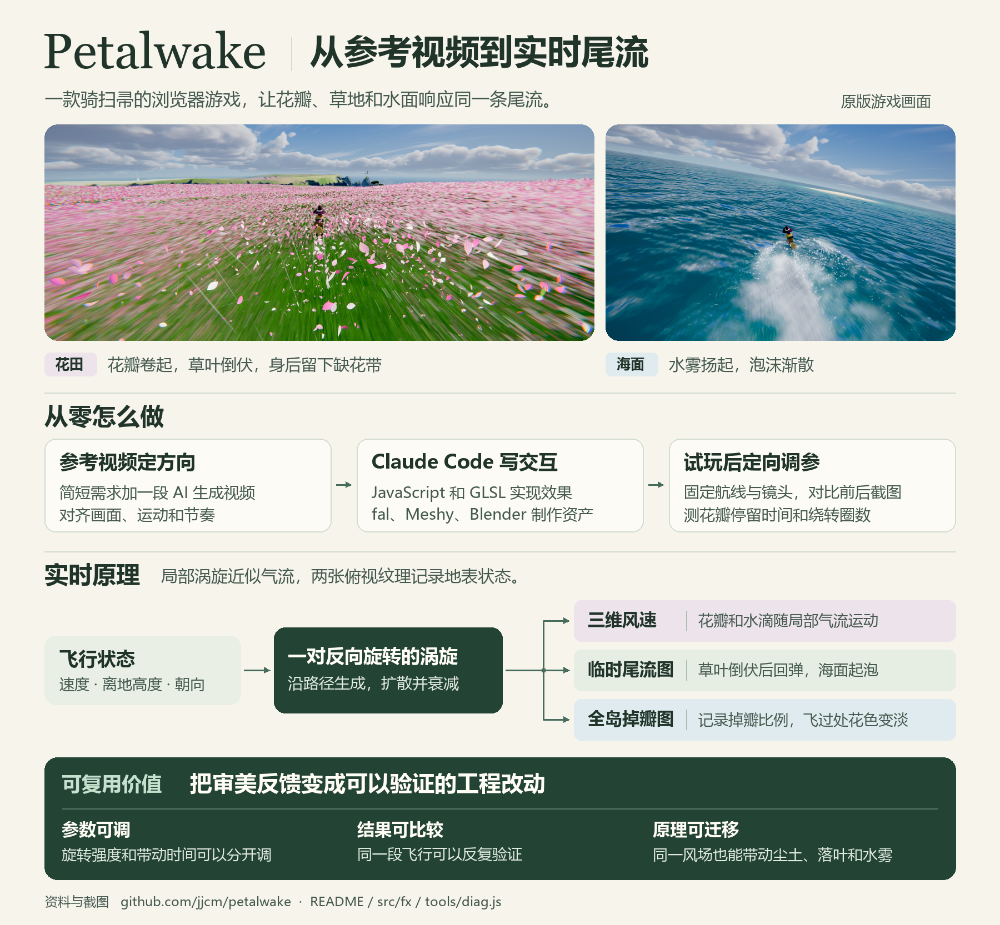
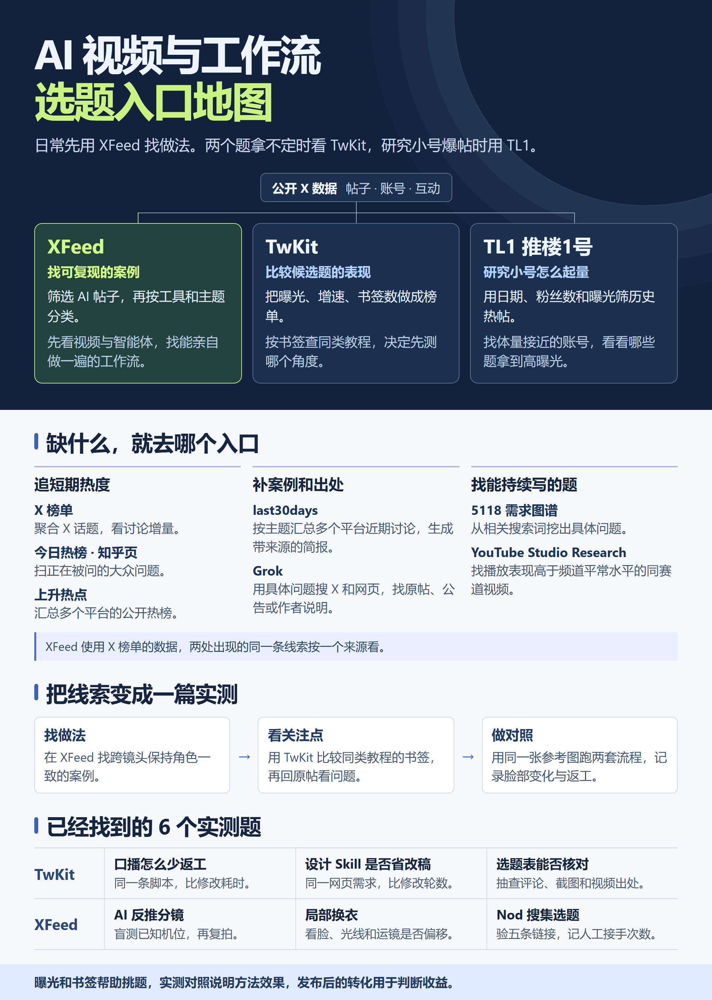

# GitHub 项目研究

记录值得深入研究的 GitHub 项目和可复用的产品探索，整理研究问题、实现方式与验证结果。每个子项目有独立的研究记录，可附截图与 Web 演示。

[打开研究库线上目录](https://yydshly.github.io/1123_codex_project/)

## 项目索引

| 编号 | 研究项目 | 摘要 | 预览 | Web 演示 |
| --- | --- | --- | --- | --- |
| 001 | [Motion2MixamoRig](projects/001-motion2mixamorig/README.md) | 从单人视频提取动作，或从全身照片估计姿势，再将动作或姿势迁移到可更换的已绑定 3D 角色。一次提取可让多个角色复用同一段表演，便于短片换机位、跨镜头衔接和制作可编辑的动画初稿。 | [引导图](#motion2mixamorig-引导图) | 未部署 |
| 002 | [AI 出海变现五方向](projects/002-ai-overseas-revenue/README.md) | 用可操作的原型验证独立站、网页小游戏、数字商品、自动化服务和内容本地化。对我们最直接的积累是可复用的字幕质检、翻译审校和交付流程，可用一单检验客户付款、发布采用和交付工时。 | [引导图](#ai-出海变现引导图) | [在线总览与原型](https://yydshly.github.io/1123_codex_project/002-ai-overseas-revenue/) · [本机运行](projects/002-ai-overseas-revenue/README.md#本机打开网页) |
| 003 | [AI 控制 Blender 的四轮建模工作流](projects/003-blender-workflow/README.md) | 让 AI 通过 Python 控制 Blender，按灰模、倒角、材质、灯光四轮逼近建模目标。每轮用同机位预览和检查数值定位偏差，定点修改并重渲复验，还能复用场景批量出变体。 | [引导图](#blender-四轮建模引导图) | 未部署 |
| 004 | [七个工具的价值与实践成果](projects/004-ai-tool-entry-lab/README.md) | 覆盖资料研读、联网查源、在线课程、翻译与术语、图像编辑、数学可视化和视频试镜。用论文、角色素材和扫描动画展示怎样保存可查的出处、可改的素材与可复算的结果，附两套 Word 与 Excel 校对原型。 | [引导图](#七个工具研究引导图) | [在线手册与演示](https://yydshly.github.io/1123_codex_project/004-ai-tool-entry-lab/) |
| 005 | [从 Next Token Skill 到 GEO](projects/005-geo-discovery-guide/README.md) | 从播客 RSS 和本地检索入手，用 AI 视频角色一致性实测练习跨站查证。再把方法用于 SEO 与 GEO，研究怎样发布可抓取、可引用的证据，让还不知道产品名的人也有机会按需求找到它，并用无品牌词问题验证效果。 | [引导图](#搜索seo-与-geo-引导图) | [在线指南](https://yydshly.github.io/1123_codex_project/005-geo-discovery-guide/) |
| 006 | [AI 产品雷达](projects/006-ai-product-radar/README.md) | 从公开营收榜、产品转让市场和发布目录收集付费 AI 产品，记录客户、交付、定价和可查的营收与增长。用付费线索筛选我们能报价、能交付、值得试单的方向。 | [引导图](#ai-产品雷达引导图) | [在线网页](https://yydshly.github.io/1123_codex_project/006-ai-product-radar/) |
| 007 | [Petalwake 实时尾流](projects/007-petalwake/README.md) | 原库用 Three.js、WebGL2 和 GLSL 模拟扫帚尾流，卷起花瓣、水雾，压弯草叶并留下掉瓣轨迹。对我们最有价值的是把参考视频的观感写成可调规则，用固定航线、截图和粒子指标验证改动。 | [引导图](#petalwake-实时尾流引导图) | [在线研究与原版试玩](https://yydshly.github.io/1123_codex_project/007-petalwake/) |
| 008 | [TanStarter 源码模板研究](projects/008-tanstarter-research/README.md) | TanStarter 接好账号、收款和运营后台，MkImage 在同一底座上实现积分生图、异步任务和作品库。对照七款模板，判断哪些工作值得复用，以及现有 AI 入口该先验证什么。 | [引导图](#tanstarter-源码模板引导图) | [在线研究网页](https://yydshly.github.io/1123_codex_project/008-tanstarter-research/) |
| 009 | [海堤街景研究](projects/009-coastal-street-study/README.md) | 从《潮线失序》公开试玩拆解海滨氛围、驾驶和路线引导，对照 [《镜海》原库](https://github.com/yydshly/mirror-coast-web)，用 Sidmouth 实拍校准 30 米样段。做成约 130 米的原创街区，可步行上车、沿支路停车下车、使用望远镜并汇回主街。 | [引导图](#海堤街景研究引导图) | [在线研究](https://yydshly.github.io/1123_codex_project/009-coastal-street-study/) · [3D 试玩](https://yydshly.github.io/1123_codex_project/009-coastal-street-study/demo/) |
| 010 | [Reddit 运营实战研究](projects/010-reddit-ops-research/README.md) | 整理 13 位中文创作者的 37 条运营资料，核对 3 个版块与 12 条 AI 视频角色相关原帖，提炼 5 类重复痛点。把双人对白问题做成首轮对照测试，用创作者实际选型和重做判断决定先做选型库还是镜头验收工具。 | [引导图](#reddit-运营实战引导图) | [在线研究网页](https://yydshly.github.io/1123_codex_project/010-reddit-ops-research/) |
| 011 | [用 AI 复盘项目的历史 bug](projects/011-ai-bug-history/README.md) | 从当前仓库的提交、旧修复和审查评论中找出反复出现的故障，验证它们是否有共同根因。把最值得修的共用逻辑改成可执行的约束，再用旧案例检验它能否拦住同类问题。 | [引导图](#ai-复盘历史-bug-引导图) | 未部署 |
| 012 | [开源实时数字人研究](projects/012-realtime-avatar-research/README.md) | 对照 LiveTalking 的本地口型引擎、赛博小雅的 Vidu 互动舞台和 Gary AI 的直播间工作台，说明各自需要的素材、服务和可复用能力。再用三种本地单图模型判断口播、可控表情和指令动作分别适合哪条路线。 | [引导图](#开源实时数字人引导图) | 未部署 |
| 013 | [AI 时代值得做的小团队 App](projects/013-paid-app-workflows/README.md) | 从 App Store 营收估算追到公开实收和客户原评，再拆解摄影师从 NAS、网盘发图到回找原片的流程。优先验证能减少返工的环节，尤其是定制订单中把客户确认的那一版准确交给生产。 | [引导图](#ai-时代小团队-app-研究引导图) | 未部署 |
| 014 | [AI 出海案例研究](projects/014-ai-founder-case-studies/README.md) | 从公开产品、社区和搜索记录追到获客、收费与收入出处。十位实践者及九张图展示真实页面、用户路径和可查结果，帮助判断自己的项目该先验证什么、推广能否回本。 | [引导图](#ai-出海案例研究引导图) | [在线案例研究](https://yydshly.github.io/1123_codex_project/014-ai-founder-case-studies/) |
| 015 | [AI 视频与工作流选题指南](projects/015-ai-topic-source-guide/README.md) | 对照 XFeed 的案例精选、TwKit 的互动排行和 TL1 的小号样本筛选，说明 10 个入口如何找题和查源。网页整理了 6 份有出处、步骤和记录指标的实测方案，帮助创作者把资讯缩成能复现、能比较的内容选题。 | [引导图](#ai-视频与工作流选题引导图) | [在线选题指南](https://yydshly.github.io/1123_codex_project/015-ai-topic-source-guide/) |

## Motion2MixamoRig 引导图


图中用同一场走廊戏对比两条制作路线。想让角色按照指定节奏停步、回头，并在转身过程中换机位时，可以把一次真人表演保留为 3D 骨骼动画。只需一个能讲清剧情的镜头时，可以直接生成视频。 [研究详情](projects/001-motion2mixamorig/README.md) · [高清 PNG](projects/001-motion2mixamorig/images/motion2mixamorig-guide.png)

## AI 出海变现引导图

[](projects/002-ai-overseas-revenue/research-overview.png)

逐项对照五个方向的研究问题、原型实测和用户价值。优先用内容本地化做一笔真实试单，记录客户是否付款、字幕是否用于发布及交付总工时。 [子项目详情](projects/002-ai-overseas-revenue/README.md) · [高清 PNG](projects/002-ai-overseas-revenue/research-overview.png)

## Blender 四轮建模引导图

[](projects/003-blender-workflow/images/blender-workflow-skill-card.png)

左侧用原创桌面剪辑控制器展示灰模修正、倒角、材质、终稿与配色变体，右侧整理了可直接交给 AI 的执行和验收规则。 [研究详情](projects/003-blender-workflow/README.md) · [高清 PNG](projects/003-blender-workflow/images/blender-workflow-skill-card.png)

## 七个工具研究引导图

[](projects/004-ai-tool-entry-lab/web/assets/tool-research-summary.png)

一张图对照工具价值、已做出的效果和项目里能留下的资产。底部展示参考图两版、同公式两站实测和无书签论文校对。 [研究详情](projects/004-ai-tool-entry-lab/README.md) · [在线成果汇总](https://yydshly.github.io/1123_codex_project/004-ai-tool-entry-lab/#summary)

## 搜索、SEO 与 GEO 引导图

[](projects/005-geo-discovery-guide/web/seo-geo-overview.png)

从查找现有实测到发布自己的证据，沿同一个角色一致性问题看清 SEO 和 GEO 各自的作用。图中也标出 Skill 或能力对应的产品扩展。 [研究详情](projects/005-geo-discovery-guide/README.md) · [在线指南](https://yydshly.github.io/1123_codex_project/005-geo-discovery-guide/) · [高清 PNG](projects/005-geo-discovery-guide/web/seo-geo-overview.png)

## AI 产品雷达引导图

[](projects/006-ai-product-radar/ai-research-value.png)

首轮从 13 个公开入口整理 16 个产品样本。用口播后期示例说明如何核对付费线索、确定交付与报价，再用真实订单记录付款、采用和成本。 [研究详情](projects/006-ai-product-radar/README.md) · [在线网页](https://yydshly.github.io/1123_codex_project/006-ai-product-radar/)

## Petalwake 实时尾流引导图

[](projects/007-petalwake/web/assets/guide.png)

沿着原版截图看三种反馈，再看怎样把参考视频的观感转换成实时规则，使用脚本试飞和粒子指标验证调整。 [研究详情](projects/007-petalwake/README.md) · [在线研究与原版试玩](https://yydshly.github.io/1123_codex_project/007-petalwake/)

## TanStarter 源码模板引导图

[](projects/008-tanstarter-research/web/assets/tanstarter-value-map.png)

模板的价值来自已经接好的源码和流程。图中对照开发者、创作者和运营团队分别为什么付费，并记录我们可以先用现有入口验证可发布素材包。 [研究详情](projects/008-tanstarter-research/README.md) · [在线研究网页](https://yydshly.github.io/1123_codex_project/008-tanstarter-research/)

## 海堤街景研究引导图

[](projects/009-coastal-street-study/web/assets/coastal-street-research-summary.png)

从参考游戏和街景实拍提取能执行的尺度、材质、交互与验收约束，再沿同一路线实机检查驾驶、停靠和观景。 [研究详情](projects/009-coastal-street-study/README.md) · [在线试玩](https://yydshly.github.io/1123_codex_project/009-coastal-street-study/demo/)

## Reddit 运营实战引导图

[](projects/010-reddit-ops-research/web/reddit-overview.png)

社群帮助我们找到人，原帖和评论提供任务、失败与替代做法。图中把这些证据连接到双人对白实测，说明如何用创作者的实际使用行为决定先做选型库还是镜头验收工具。[研究详情](projects/010-reddit-ops-research/README.md) · [在线研究网页](https://yydshly.github.io/1123_codex_project/010-reddit-ops-research/) · [高清 PNG](projects/010-reddit-ops-research/web/reddit-overview.png)

## AI 复盘历史 bug 引导图

[](projects/011-ai-bug-history/images/ai-bug-history-summary.png)

以日记重复保存为例，说明怎样从几个看似独立的故障找出值得验证的共同原因，再用同一历史案例检查修复前后的结果。 [研究详情](projects/011-ai-bug-history/README.md) · [高清 PNG](projects/011-ai-bug-history/images/ai-bug-history-summary.png)

## 开源实时数字人引导图

[](projects/012-realtime-avatar-research/images/realtime-avatar-projects.png)

图中对照谁负责画面、声音和回复，以及我们能复用的是口型能力、互动表演还是直播间调度。 [研究详情](projects/012-realtime-avatar-research/README.md) · [高清 PNG](projects/012-realtime-avatar-research/images/realtime-avatar-projects.png)

## AI 时代小团队 App 研究引导图

[](projects/013-paid-app-workflows/images/ai-app-research-map.png)

从客户已经在做的事出发，比较哪一步能省工时、避免返工或推进成交。我们的首选是用真实定制订单验证客户确认稿与生产原件能否准确交接。 [研究详情](projects/013-paid-app-workflows/README.md) · [高清 PNG](projects/013-paid-app-workflows/images/ai-app-research-map.png)

## AI 出海案例研究引导图

[](projects/014-ai-founder-case-studies/web/sitin-toolcenter-sparkvid-map.png)

用真实的 SparkVid 收录页沿着曝光、进站、跳转官网看一遍，再根据每单收益和转化率计算回本所需的来访。图中标明站长披露的数据、实查页面和测算假设。 [在线引导案例](https://yydshly.github.io/1123_codex_project/014-ai-founder-case-studies/#case/sitin/toolcenter) · [研究详情](projects/014-ai-founder-case-studies/README.md)

## AI 视频与工作流选题引导图

[](projects/015-ai-topic-source-guide/web/ai-topic-entry-summary.png)

从 XFeed 找可复现的做法，按需要用 TwKit 核对同类帖的收藏表现，或用 TL1 找同体量的小号样本。选定题目后用同一份素材做对照，记录效果和返工次数。 [研究详情](projects/015-ai-topic-source-guide/README.md) · [在线指南](https://yydshly.github.io/1123_codex_project/015-ai-topic-source-guide/) · [六个实测选题](https://yydshly.github.io/1123_codex_project/015-ai-topic-source-guide/#topics)

## 收录约定

1. 按收录顺序从 `001` 开始编号，目录命名为 `projects/001-project-name/`。新增项目使用下一个编号，已分配的编号保留。
2. 复制[子项目模板](projects/_template/README.md)到新目录，记录原仓库、研究基线、核心发现和验证过程。演示源码可放在子项目的 `web/` 目录。
3. 在索引中按编号追加一行，链接到子项目 README，用一两句话说明研究重点。索引可放一张代表图，完整截图放在子项目的 `images/` 目录，在 README 为图片添加替代文字和图注。

## Web 演示

各演示共用 GitHub Pages 站点，按编号划分子路径。首页维护在 `docs/index.html`。组装站点时使用 009 的 Vite 构建产物。提交到 `main` 后，Pages 工作流会自动构建并发布。

在本机用 Node.js 22.12 或以上版本构建到一个尚未创建的输出目录。

```sh
npm --prefix projects/009-coastal-street-study/demo ci
npm --prefix projects/009-coastal-street-study/demo run build
python scripts/build_pages.py _site/preview
```

002 的音频对齐、广告周报计算和视频识别翻译在各自的 Python 服务上运行。线上总览附实测记录与本机启动说明。 [本机运行](projects/002-ai-overseas-revenue/README.md#本机打开网页) · [GitHub Pages 自定义工作流](https://docs.github.com/en/pages/getting-started-with-github-pages/using-custom-workflows-with-github-pages)
