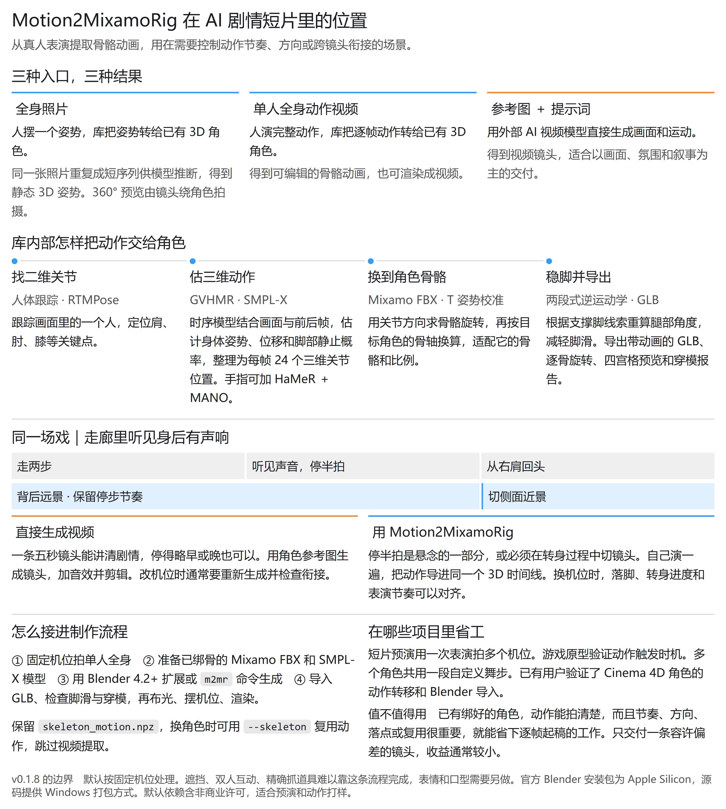

# Motion2MixamoRig

- **编号** `001`
- **原仓库** [MaxLiu22/Motion2MixamoRig](https://github.com/MaxLiu22/Motion2MixamoRig)
- **研究基线** [v0.1.8](https://github.com/MaxLiu22/Motion2MixamoRig/releases/tag/v0.1.8)
- **上游许可证** 项目代码为 Apache-2.0。默认动作提取流程中的 GVHMR 和 SMPL-X 等上游组件有非商业用途限制。 [许可说明](https://github.com/MaxLiu22/Motion2MixamoRig/blob/v0.1.8/NOTICE.md)
- **Web 演示** 未部署

## 导读

Motion2MixamoRig 可以从一段单人全身视频提取三维动作，也可以从一张全身照片估计静态姿势。选一个已绑定 Mixamo 骨骼的 3D 角色，把动作或姿势迁移过去，输出可在 Blender 等软件中继续编辑的角色资产。换一个目标角色时可以复用同一份骨架数据，让不同角色演同一段动作。**表演来自输入素材，角色外观来自所选的 3D 角色。** [项目说明](https://github.com/MaxLiu22/Motion2MixamoRig/blob/v0.1.8/README.md)

## 研究发现

| 输入 | 能力与输出 | 常见用途 |
| --- | --- | --- |
| 单张全身照片 ＋ 已绑定角色 | 暂时把同一帧重复成短视频供模型推断，再把静态姿势迁移到目标角色。附带的环绕预览用镜头展示这个姿势。 | 定姿、测试角色造型和多角度展示 |
| 单人全身视频 ＋ 已绑定角色 | 估计一段连续的三维动作。输出可编辑的 `mixamo_character.glb`、可复用的 `skeleton_motion.npz`、逐骨旋转、对照预览和穿模报告。 | 把真人表演转成动画初稿，换机位或换角色后继续制作 |
| 角色参考图 ＋ 提示词 | 由外部 AI 视频模型直接生成画面与运动，得到一个可剪辑的视频镜头。 | 一次性镜头、动作容许偏差、主要依靠构图和氛围叙事 |

来源见[照片与视频提取入口](https://github.com/MaxLiu22/Motion2MixamoRig/blob/v0.1.8/motion2mixamorig/extractors/gvhmr.py#L269-L336)和[输出说明](https://github.com/MaxLiu22/Motion2MixamoRig/blob/v0.1.8/README.md#outputs)。第三行是短片制作方案的对照。

1. **模型估计身体怎么动。** 视频预处理追踪画面中的人，用 RTMPose 找肩、肘、膝等二维关键点。GVHMR 结合画面与相邻帧估计三维身体姿势、根节点位移和脚部静止概率，再借助 SMPL-X 转成每帧 24 个三维关节位置。手指动作可额外使用 HaMeR 和 MANO。 [GVHMR 方法](https://zju3dv.github.io/gvhmr/) · [提取源码](https://github.com/MaxLiu22/Motion2MixamoRig/blob/v0.1.8/motion2mixamorig/extractors/gvhmr.py)
2. **库计算目标角色的骨骼旋转。** 用人体关节方向计算骨骼转动，再借助目标角色的 T 姿势做坐标换算，使动作适配它的骨轴与比例。 [骨骼映射源码](https://github.com/MaxLiu22/Motion2MixamoRig/blob/v0.1.8/motion2mixamorig/mixamo/retarget.py#L423-L471) · [坐标换算](https://github.com/MaxLiu22/Motion2MixamoRig/blob/v0.1.8/motion2mixamorig/mixamo/ybot_retarget.py#L11-L21)
3. **后处理稳脚并导出。** 根据模型给出的脚部线索，用两段式逆运动学调整腿部，必要时微调髋部。GLB 包含目标角色网格、骨骼与动画。自相交报告可定位穿模部位和问题帧，便于人工修整。 [脚锁定源码](https://github.com/MaxLiu22/Motion2MixamoRig/blob/v0.1.8/motion2mixamorig/mixamo/foot_lock.py) · [导出和诊断源码](https://github.com/MaxLiu22/Motion2MixamoRig/blob/v0.1.8/motion2mixamorig/pipeline.py#L218-L239)

## 在 AI 剧情短片里怎么选

**同一场戏**里，角色在走廊走两步，听见身后响动，停半拍，再从右肩回头。

- **直接生成视频**。一个五秒镜头能讲清这件事，回头早晚一点也不影响观众理解。用参考图生成镜头、配音效、剪进成片即可。
- **用 Motion2MixamoRig**。那半拍决定悬念，或者必须在转身中间从背后远景切到侧面近景。先把完整动作演一遍，做成一条 3D 时间线。两个机位可以保留同一个落脚点、停顿和转身进度。换镜头时可以继续用这条动作。

它的价值集中在能拍清楚、需要控制身体表演的镜头。已有绑好的角色时，可以用真人表演缩短逐帧起稿的工作，也可以把同一段动作留给多机位短片预演、游戏动作原型或多个角色。手上只有角色参考图时，还要准备 3D 模型、绑骨、搭景和渲染，普通镜头的收益通常较小。 [骨架复用说明](https://github.com/MaxLiu22/Motion2MixamoRig/blob/v0.1.8/README.md#3-same-motion-different-character)

## 用法与适用边界

1. 用固定机位录一段单人全身动作，或准备清晰的单人全身照片。准备目标角色的 Mixamo FBX 和单独获取的 SMPL-X 文件。
2. 在 Blender 4.2+ 扩展里选择素材和角色，或通过 `m2mr` 命令行生成。保留 `skeleton_motion.npz`，下次换角色时通过 `--skeleton` 复用骨架，跳过视频动作提取。
3. 在 Blender 时间线上检查脚滑和穿模，需要时编辑关键帧，再布光、摆镜头和渲染。表情、口型和精确的手与道具接触需要另外制作或修整。 [中文使用指南](https://github.com/MaxLiu22/Motion2MixamoRig/blob/v0.1.8/docs/i18n/user-guide.zh-Hans.md) · [动作复用说明](https://github.com/MaxLiu22/Motion2MixamoRig/blob/v0.1.8/README.md#3-same-motion-different-character)

v0.1.8 默认按固定机位处理，检测到多人同框时会中止。肢体遮挡、跟拍和精确互动会影响动作或场景位移的可信度。官方扩展包为 Apple Silicon，源码提供 Windows 打包方式。 [提取参数](https://github.com/MaxLiu22/Motion2MixamoRig/blob/v0.1.8/motion2mixamorig/extractors/gvhmr.py#L301-L336) · [发布说明](https://github.com/MaxLiu22/Motion2MixamoRig/releases/tag/v0.1.8) · [源码打包](https://github.com/MaxLiu22/Motion2MixamoRig/blob/v0.1.8/blender_extension/README.md#build-and-install-the-add-on)

## 验证记录

本条目依据 GVHMR 论文、Motion2MixamoRig v0.1.8 的文档和源码，以及公开测试反馈整理。仓库 Issue 中已有贡献者报告，采用他所述的设置时，经 Cinema 4D 导出的 Mixamo 角色能在 Blender 中正常显示并播放转移后的动作。这次研究未安装或运行该库，实际素材的捕捉成功率、修整工时和出片质量待实测。 [公开测试反馈](https://github.com/MaxLiu22/Motion2MixamoRig/issues/8)

## 截图与说明

本次研究整理的引导图。 [打开高清 PNG，3000 × 3339 像素](images/motion2mixamorig-guide.png)
