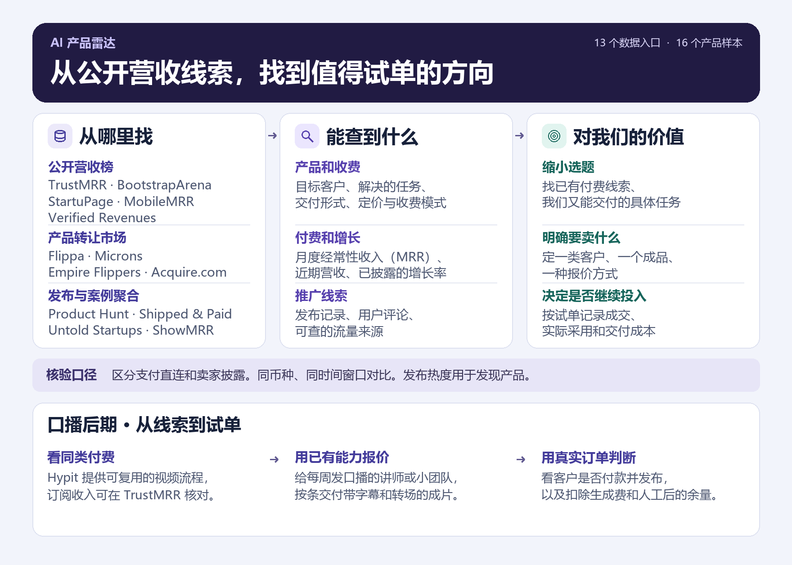

# AI 产品雷达

[返回 002 AI 出海变现](../README.md) · [打开在线网页](https://yydshly.github.io/1123_codex_project/002-ai-overseas-revenue/06-ai-product-radar/) · [查看研究导图原图](ai-research-value.png)

AI 产品雷达的核心能力是**发现和收集已有付费线索的 AI 产品**。首轮从 13 个公开营收榜、产品转让市场和发布目录整理出 16 个产品样本，记录目标客户、交付内容、收费方式，以及能查到的营收、增长、数据日期和来源。

我们按赛道、营收、增长或近期收录浏览公开榜单和交易市场，也用发布目录补充候选。找到产品后，回到支付直连榜或交易详情核对付费线索，聚合站转引的数据沿链接追溯原出处。支付直连和挂牌披露分别标注，金额和增长按相同口径、币种和时间窗口对照。

这些样本帮助我们挑一类能触达的客户、一项能交付的成果和一种报价方式。首轮优先考虑口播后期，再用成交、成片采用、人工工时和生成成本决定是否继续投入。

## 使用网页

也可直接用浏览器打开 `index.html`。筛选、图表和样本比较在浏览器运行，无需安装依赖。原始来源链接需要联网。

- **产品样本**按方向、数据来源和证据筛选。点详情可查看目标客户、产品交付、收费方式、营收口径和出处。每次可比较两个或三个案例，也可导出当前筛选结果为 CSV。
- **营收与增长**可以切换支付直连的美元 MRR、30 天净营收变化、30 天 MRR 变化。图表跟随产品筛选，样本统计按全部已整理案例计算。增长图以 0 为中心，左右表示下跌和上涨。
- **数据对照**展示同币种的挂牌 MRR、同窗口的移动端收入，以及同指标的两个日期快照。样本覆盖可一键筛选数据来源。
- **数据入口**保存每个榜单、市场或发布目录的用途、各自的验证方式和公开范围。
- **机会分析**把案例对应到口播后期、单品上架素材和视频学习练习三个可以实际交付的场景。每个方向可展开采集指标、继续条件和暂停条件。

首版于 2026 年 11 月 22 日核对公开资料。数字来自不同日期的支付快照或挂牌披露。字段有明确日期、币种、时间窗口、验证方式和链接。因数据源会更新，页面保留核对时的快照。

`research-data.js` 存放入口、产品和分析结论。更新时保留原指标和原币种，检查支付直连和卖家披露的区别，并标注来源同步日期。没有公开增长时留空即可。
