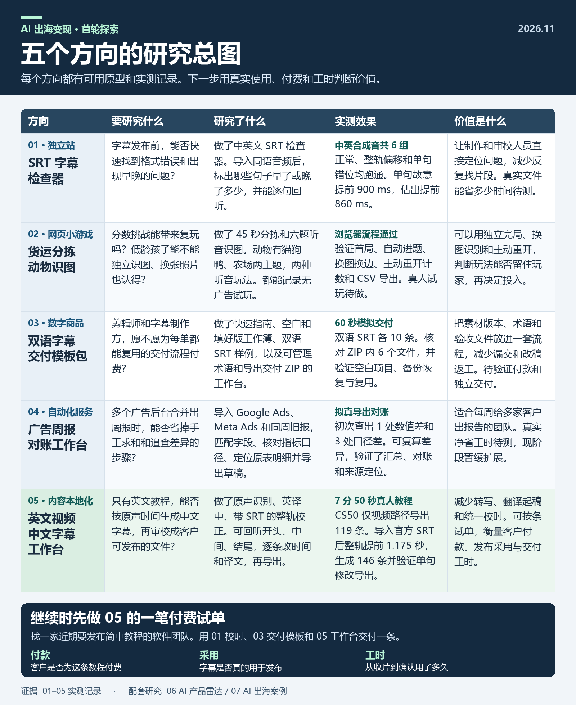

# AI 出海变现｜首轮探索总目录

研究总库编号 **002**。 [返回项目索引](../../README.md#项目索引)

[打开线上总览](https://yydshly.github.io/1123_codex_project/002-ai-overseas-revenue/) · [查看研究总图](research-overview.png)

这轮研究用可操作的原型探索了五种 AI 出海变现方向。每项记录目标用户、实际交付、样例或原片实测，以及后续检验复玩、省时或付款的办法。我们积累了可复用的字幕质检、翻译审校和交付流程，也能据此决定哪些方向值得再投入。 [原帖](https://x.com/CryY666666/status/2123996319069151738)

[](research-overview.png)

| 子项目 | 做出了什么 | 实际验证 | 继续时先做 |
| --- | --- | --- | --- |
| [01 独立站探索](01-independent-website/README.md) | 中英文 SRT 格式检查、同语音频对齐、早晚提示和原声回听 | 两种语言各跑了正常、整轨偏移、单句错位三种合成音样例。[记录](01-independent-website/RESULTS.md) | 让字幕制作者用自有素材核对一条，比较复核耗时。 |
| [02 网页小游戏探索](02-browser-game/README.md) | 货运分拣与《动物在哪里？》两个无广告原型，含试玩记录 | 浏览器验证首局、重开、换图和 CSV 导出。真人试玩待收集。[记录](02-browser-game/RESULTS.md) | 先让孩子试动物游戏，观察独立完成、换图识别和主动重开。 |
| [03 数字商品](03-digital-products/README.md) | 可下载双语字幕交付包及可复用网页工作台 | 以自制 60 秒演示跑完模拟交付，验证双语字幕轨、打包和复用。[记录](03-digital-products/RESULTS.md) | 找有在手订单的剪辑师，验证付费和独立交付。 |
| [04 自动化服务](04-automation-service/README.md) | Google Ads、Meta Ads 和旧周报的对账、追溯与导出工作台 | 拟真 CSV 验证了 1 处数值、3 处口径差异及来源定位。[记录](04-automation-service/RESULTS.md) | 暂缓扩展。若有真实团队，用一周历史报表复跑并记录净省工时。 |
| [05 内容本地化](05-content-localization/README.md) | 英文视频识别、SRT 整轨校正、英译中、逐条审校及导出工作台 | CS50 真人教程跑通两条路径，整轨校正建议提前 1.175 秒，实测导出包含单条修改。[记录](05-content-localization/RESULTS.md) | 接一单近期要发布的简中教程，记录付款、采用和交付总工时。 |

## 继续顺序

**优先继续 05，先做一笔有偿试单。** 真人长视频已跑通，本机工作台可完成交付。试单可以同时验证客户是否付款、是否用于发布、从收片到确认用了多少工时，并观察 01 的校时与 03 的模板是否减少返工。公网部署与算力成本目前为方案估算。

## 本机打开网页

在本子项目目录（包含 `index.html` 的目录）启动总览，然后访问 [本机首页](http://127.0.0.1:8846/)。

```powershell
python -m http.server 8846 --bind 127.0.0.1
```

网页上的格式检查器、游戏、交付模板和研究资料由总览服务提供。音频对齐、广告对账和自动识别翻译使用各自的本机服务，按子目录说明启动。语音与翻译模型可按说明在本机准备。

- [01 音频对齐](01-independent-website/README.md#音频与字幕对齐)
- [04 广告周报对账](04-automation-service/README.md)
- [05 字幕本地化工作台](05-content-localization/README.md#可复用字幕工作台)

## 配套市场研究

**006 AI 产品雷达**收集付费 AI 产品及可查的营收与增长，为试单选题提供线索。 [在线网页](https://yydshly.github.io/1123_codex_project/006-ai-product-radar/) · [研究说明与引导图](../006-ai-product-radar/README.md)

**014 AI 出海案例研究**整理十位实践者的需求、交付、获客与收费，用真实产品页和收入出处比较推广与付费验证的方法。 [在线网页](https://yydshly.github.io/1123_codex_project/014-ai-founder-case-studies/) · [研究说明与引导图](../014-ai-founder-case-studies/README.md)
