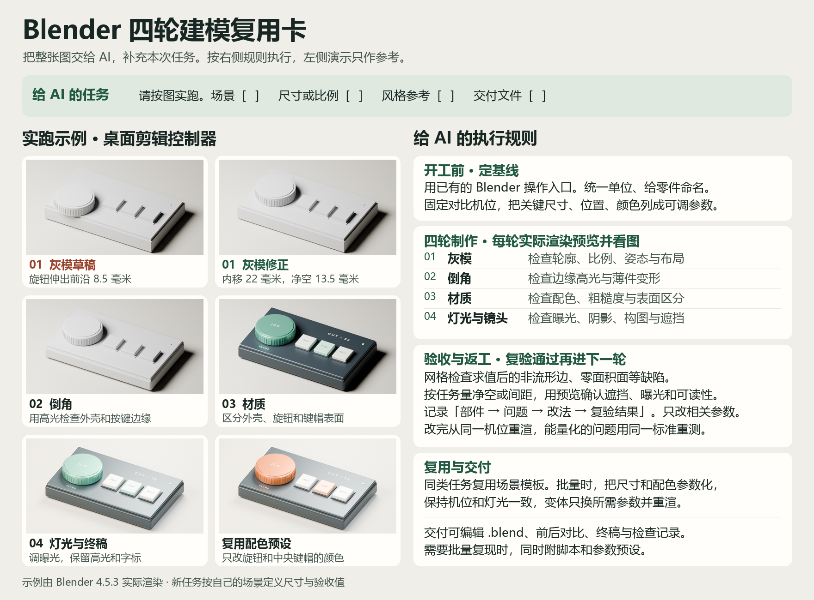

# AI 控制 Blender 的四轮建模工作流

- **编号** `003`
- **来源** [0xAnni 的 X 长文](https://x.com/0x_Anni/status/2113388647487774863) · [全文镜像](https://teapaw.org/0x_Anni/article/2113388647487774863)
- **实跑环境** Blender 4.5.3 LTS · Cycles CPU
- **Web 演示** 未部署

## 摘要

这套工作流的价值是让 AI **更可控地用 Blender 做出符合目标、还能继续编辑的 3D 模型和渲染图**。AI 把参考图、尺寸和风格要求转成有名称的部件及可调参数，调用 Blender 的 Python 接口逐轮建模和渲染。每轮对照预览图和检查数值，只修当前阶段的问题，再从同一机位重渲确认。相机、灯光、材质和检查逻辑可以复用，同类道具也能沿用一套场景批量出变体。

原文介绍了共用 Python 工具库 `studio.py`。目前查到的公开入口是文章与示例片段，完整工具库的独立网页和下载入口尚未查到。本目录的脚本是我们按该方法编写的实跑示例。

## 引导图

左侧是实跑对比，右侧是可以交给 AI 执行的规则。复用时附上本次的场景、尺寸或比例、风格和交付要求。



## 它怎样控制 Blender

1. **把目标转成 Blender 可执行的操作。** 统一单位，为零件命名，把尺寸、位置和材质写成参数。原文由 AI 编写 Python，调用 Blender 的 `bpy` 和 `bmesh`，再通过命令行在后台执行。`studio.py` 集中管理重复用到的几何、材质、相机、灯光和检查函数。
2. **用阶段参数控制每一轮做什么。** 同一个场景先出灰模确认轮廓、比例和布局，再加倒角看边缘，接着调配色和粗糙度，最后检查灯光、曝光和构图。前后固定对比机位，方便看清这轮改动。
3. **把渲染和检查结果交回给 AI。** Blender 输出预览图和检查报告。模型据此定位到部件及参数，用小改动修正，再重渲复验。拓扑问题按网格报告检查，净空、遮挡和可读性按项目目标另行验收。
4. **把反复用到的控制方式保留下来。** 现有的 Blender 操作入口也可以沿用这套分轮验收。需要批量出图或长期迭代时，再把场景模板、参数预设和检查规则写进脚本。

## CUT / 03 实跑

这是一台用于逐帧定位、播放和跳转的桌面剪辑控制器概念模型。场景和脚本为本次演示新建，尺寸为视觉和布局验证服务。

灰模中，旋钮伸出面板前沿 8.5 毫米，网格报告仍为零缺陷。把旋钮内移 22 毫米后，同机位预览和净空检查共同确认它留出了 13.5 毫米。配色变体保留几何、机位和灯光，只替换旋钮和中央键帽的颜色。这两步分别验证了修改能复验、场景能复用。[灰模草稿](renders/layout-draft.png) · [修正布局](renders/layout.png) · [倒角](renders/edges.png) · [材质](renders/materials.png) · [薄荷绿终稿](renders/final.png) · [铜橙变体](renders/variant.png)

[实跑报告](renders/report.json) · [可编辑 Blender 工程](renders/cut-03.blend)

## 复现

在本目录执行以下命令。若 Blender 未加入 PATH，将 `blender` 换成可执行文件路径。

```powershell
blender --background --factory-startup --python-exit-code 1 --python build_controller.py -- --stage all
```

用 `--stage layout` 单跑修正后的灰模，或用 `--stage variant` 单跑铜橙配色。`build_controller.py` 中的 `PALETTES` 定义了两种配色。输出在 `renders`，其中 `cut-03.blend` 是可编辑的薄荷绿终稿，`report.json` 汇总了每轮检查。[lighting-draft.png](renders/lighting-draft.png) 保留了首次灯光试渲，便于对照后续曝光修正。

## 哪些步骤可以复用

| 技巧 | 在本例怎么用 | 换项目时保留什么 |
| --- | --- | --- |
| 用具名参数描述部件 | 用毫米写尺寸和位置。旋钮前后位置由一个参数控制，48 条防滑齿跟随它移动 | 真实单位、部件名称、关键尺寸和预设表 |
| 固定机位，分轮出图 | 灰模看布局，倒角轮看边缘，材质轮看颜色和粗糙度，终稿看灯光和字标。预览 720 × 540、16 采样，终稿 1200 × 900、36 采样 | 每轮要判断的问题、统一的对比机位、低成本预览设置 |
| 检查实际渲染用的网格 | 在修改器求值后统计边界边、非流形边、零面积面、孤立顶点和非正体积部件 | 按资产的用途定义可自动检查的缺陷，保存结果 |
| 单独检查装配约束 | 旋钮草稿伸出面板 8.5 毫米，65 个网格部件仍通过拓扑检查。修正后前沿净空为 13.5 毫米，本例的最低目标是 6 毫米 | 给具体项目写一两条可测约束，例如净空、可视范围或最小间距 |
| 把目测结论写成小改动 | 把旋钮沿 Y 轴移入 22 毫米。终稿字标发白后，降低光强和曝光，重渲确认 | 按“部件 → 问题 → 参数或操作 → 复验方式”记录每次修改 |
| 共用摄影棚和渲染入口 | 用同一套相机、灯位和模型，仅更换两处配色参数，生成薄荷绿和铜橙两款 | 把常用相机、灯光、命名和导出选项收进模板 |

可以把下面这句话放进现有的 Blender 模型操作流程中。

> 先出固定机位的灰模预览和尺寸报告。每轮只评当前目标，把问题定位到具体部件并给出最小修改。修改后从同一机位重渲，附上修正前后的图和能复验的数值。

这次报告的网格统计针对各个求值后的部件。旋钮净空只检查前沿，其他装配关系按本例画面复核。脚本渲染时间来自本机这一轮，未测量人工操作的耗时。
