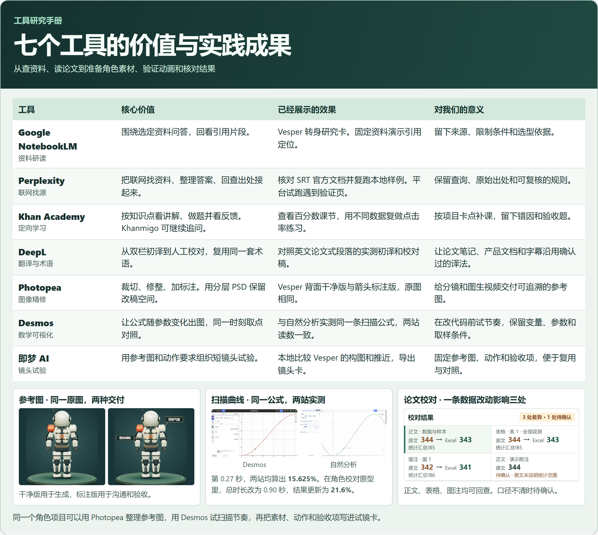

# 七个工具的价值与实践成果

[在线研究手册](https://yydshly.github.io/1123_codex_project/004-ai-tool-entry-lab/) · [成果汇总](https://yydshly.github.io/1123_codex_project/004-ai-tool-entry-lab/#summary) · [原始入口帖](https://x.com/AdrianPunk115/status/2123974547565367518)

## 摘要

研究覆盖**资料研读、联网查源、在线课程、翻译与术语、图像编辑、数学可视化和视频试镜**七个产品方向。用英文论文、Vesper 角色素材和扫描动画做案例，说明每个工具在什么环节能帮上忙，以及怎样把结果留下来。可复用的产物包括可回查的出处、练习记录、译稿与术语表、参考图、曲线参数和镜头卡。研究还做了两套 Word 与 Excel 校对原型，能把改参后的数字差异定位到原句和源单元格。

## 引导图

## 工具怎么用

| 产品方向 | 入口 | 对项目的价值 |
| --- | --- | --- |
| 资料研读 | [NotebookLM](https://yydshly.github.io/1123_codex_project/004-ai-tool-entry-lab/#notebooklm) | 在选定材料里追问，回到引用片段核对结论，保存限制条件和选型依据。 |
| 联网查源 | [Perplexity](https://yydshly.github.io/1123_codex_project/004-ai-tool-entry-lab/#perplexity/recap) | 从问题找到可追查的网页，把原始出处、适用范围和核对结果留下来。 |
| 在线课程 | [Khan Academy](https://yydshly.github.io/1123_codex_project/004-ai-tool-entry-lab/#khan/courses) | 围绕具体知识点看讲解、做练习和复测。正式课程与 Khanmigo 对话辅导各有用途。 |
| 翻译与术语 | [DeepL](https://yydshly.github.io/1123_codex_project/004-ai-tool-entry-lab/#deepl/paper) | 把初译整理成能交付的译稿，复用已确认的论文、产品文档和字幕术语。 |
| 图像编辑 | [Photopea](https://yydshly.github.io/1123_codex_project/004-ai-tool-entry-lab/#photopea/reference) | 用裁切、修整和分层标注交付参考图，保留可继续改的源稿。 |
| 数学可视化 | [Desmos 与自然分析](https://yydshly.github.io/1123_codex_project/004-ai-tool-entry-lab/#desmos/calculators) | 用曲线、滑块和取样点核对同一套参数，把公式、单位和适用范围带回动画或论文。 |
| 视频试镜 | [即梦 AI](https://yydshly.github.io/1123_codex_project/004-ai-tool-entry-lab/#jimeng/effects) | 把参考图、动作、构图和验收项写入镜头卡，便于同条件对照不同镜头方案。 |

## 已有验证

- **角色素材**。Vesper 背面交付干净版和箭头标注版，另外可在网页裁切正面图并导出 PNG。
- **公式试算**。Desmos 与自然分析输入同一条平滑扫描公式。现用总时长为 1.08 秒时，第 0.27 秒两站都读到 15.625%。
- **报告校对**。角色扫描改用 0.90 秒后，原型从 Excel 复算得到 21.6%，定位正文、表格和图注三处旧值。Palmer Penguins 样例用真实论文和公开数据制作无书签 Word，按统计口径匹配，演示三处差异和一处待确认。 [校对原型、Word 和 Excel](https://yydshly.github.io/1123_codex_project/004-ai-tool-entry-lab/#desmos/proofreading)

手册标出官方资料、网页实测和本地预演的依据。Perplexity 的 SRT 案例已查阅官方资料并复跑本地用例，平台试跑遇到验证页。即梦案例展示本地分镜和导出的镜头卡。

## 本机打开

直接打开 [web/index.html](web/index.html)。站内演示和两个校对样例使用随包文件，在浏览器内执行。 [维护与复现](web/README.md)
