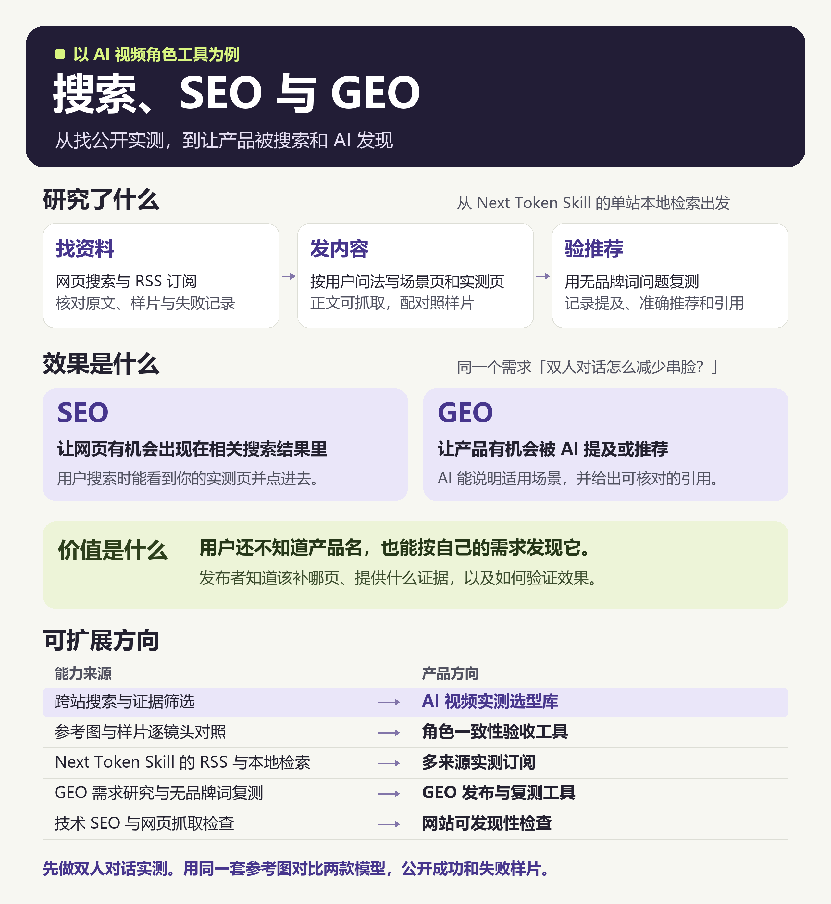

# 从 Next Token Skill 到 GEO

- **编号** `005`
- **原仓库** [next-token-tv/next-token-skill](https://github.com/next-token-tv/next-token-skill)
- **上游参考版本** [`9419b1e`](https://github.com/next-token-tv/next-token-skill/tree/9419b1e873d01eaf14ca4122c025b02281b690e4)
- **上游代码许可证** Apache-2.0
- **Web 指南** [搜索、SEO 与 GEO 实战指南](https://yydshly.github.io/1123_codex_project/005-geo-discovery-guide/)

## 摘要

研究从 Next Token Skill 入手。它从官网同步节目 RSS 和博客，把逐字稿和文章存到本地，让 Agent 能按问题查原文并引用时间戳。我们把这套「从问题找证据」的方法用在 AI 视频角色一致性上，通过网页搜索对照作者的参考素材、输出样片和失败记录。

这次检索也让我们看到发布者的机会。**用户只描述需求，还不知道产品名时，也能通过搜索结果或 AI 回答发现产品。** SEO 帮助网页出现在相关搜索结果里。GEO 让产品有机会进入 AI 的答案，并给出适用场景和依据。对应的发布做法是用真实问法写场景页和实测页，公开可核对的证据，再用无品牌词问题复测。

## 研究内容与可复用结果

| 研究内容 | 可以复用什么 |
| --- | --- |
| 单站检索与多来源查证 | 用 RSS 跟踪固定作者，用网页搜索补名单外的实测。优先保留原文、输入素材、对照样片和失败记录。 |
| AI 视频角色一致性 | 用同一组角色素材和拍摄条件对比工具。分别看脸、服装、台词归属和道具连续性，并记录生成多少次才能得到一条可用镜头。 |
| SEO 与 GEO 发布 | 给场景和实测各一个可公开访问的网址。正文包含问题、方法、证据及限制，并提供样片和试用入口。 |
| 无品牌词验证 | 用固定的问题记录产品是否被提及、推荐理由是否准确、引用指向哪一页。发布前后使用同一批问题。 |

案例来自作者公开的测试与制作复盘。指南提供验证方法，产品推荐提升仍需上线后按真实问题复测。

## 产品扩展

- **网页搜索与证据筛选**可扩展为 AI 视频实测选型库。
- **逐镜头对照参考图和样片**可扩展为角色一致性验收工具。
- **Next Token Skill 的 RSS 同步和本地检索**可扩展为多来源实测订阅。
- **需求研究与无品牌词复测**可扩展为 GEO 发布与复测工具。
- **HTML 和爬虫访问检查**可扩展为网站可发现性检查。

首个可以验证的题目是「双人对话怎么减少串脸」。用同一套角色参考图对比两款模型，公开成功与失败样片，观察用户是继续查其他拍摄场景，还是拿自己的素材来做镜头验收。

## 本机运行

用浏览器打开 [`web/index.html`](web/index.html)。页面和引导图由研究库的 Pages 工作流发布。
