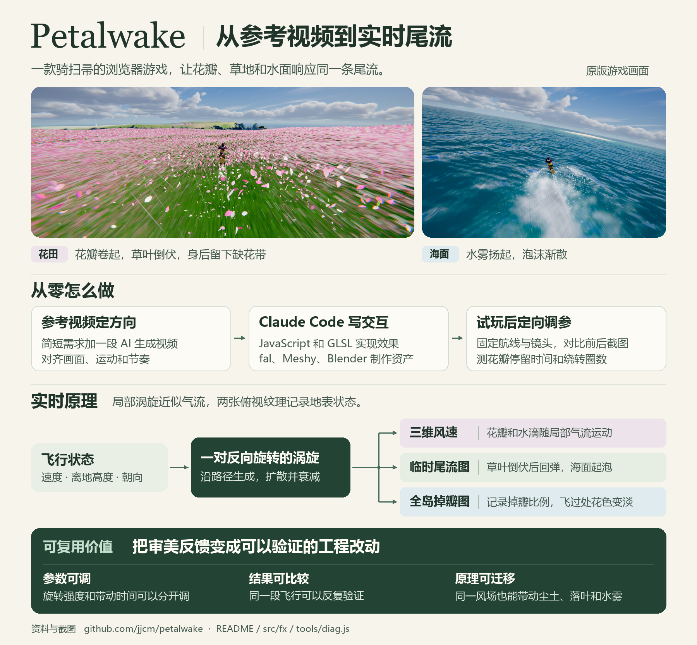

# 007 Petalwake · 从参考视频到实时尾流

[返回研究总库](../../README.md#项目索引) · [打开在线研究与试玩](https://yydshly.github.io/1123_codex_project/007-petalwake/) · [查看引导图](web/assets/guide.png)

- **原仓库** [jjcm/petalwake](https://github.com/jjcm/petalwake)
- **研究基线** [25443ce](https://github.com/jjcm/petalwake/commit/25443cef0eba802052d9ef24c94ba3c4157b6f2e)
- **上游许可证** [MIT](https://github.com/jjcm/petalwake/blob/25443cef0eba802052d9ef24c94ba3c4157b6f2e/LICENSE)

## 摘要

Petalwake 是骑扫帚低空飞行的浏览器游戏。贴着花田飞会卷起花瓣、压弯草叶，并在地表留下掉瓣轨迹。掠过海面时，同一条尾流会扬起水雾并留下渐渐消散的泡沫。原库用 JavaScript、Three.js、WebGL2 和 GLSL 模拟成对涡旋，CPU 采样空中气流，GPU 把地表受力和掉瓣比例写入两张纹理。

对我们的价值在于把参考视频里的观感变成可控制的交互。用素材确定目标，再把旋转、带动时间和地表留痕写成可调规则。通过固定输入、镜头截图和粒子指标，可以重复验证每次修改。类似做法也适用于落叶、尘土和水雾。

## 制作与实现

1. 作者用简短需求和 AI 参考视频给 Claude Code 定方向，随后提供几轮试玩反馈。代码、着色器和地形工具由 Claude Fable 5.2 编写，部分美术资产由 fal 和 Meshy 生成，再经 Blender 处理。建筑使用 Blender 脚本建模。[上游制作说明](https://github.com/jjcm/petalwake/blob/25443cef0eba802052d9ef24c94ba3c4157b6f2e/README.md#how-it-was-made)
2. 扫帚沿路径留下反向旋转的涡旋对。花瓣和水滴按各自位置采样气流，地表读取临时推力与泡沫，掉瓣图保留飞过后的变化。[涡旋](https://github.com/jjcm/petalwake/blob/25443cef0eba802052d9ef24c94ba3c4157b6f2e/src/fx/vortex.js) · [临时尾流图](https://github.com/jjcm/petalwake/blob/25443cef0eba802052d9ef24c94ba3c4157b6f2e/src/fx/wake.js) · [掉瓣图](https://github.com/jjcm/petalwake/blob/25443cef0eba802052d9ef24c94ba3c4157b6f2e/src/fx/strip.js)
3. 源码提供固定初始飞行状态、模拟输入与尺寸截图的入口。诊断脚本可统计花瓣停留时间、绕转圈数和飞起高度。可用这些指标检验观感调整，例如延长花瓣跟随扫帚的时间，同时观察旋转圈数的变化。[试飞工具](https://github.com/jjcm/petalwake/blob/25443cef0eba802052d9ef24c94ba3c4157b6f2e/src/main.js#L448) · [诊断脚本](https://github.com/jjcm/petalwake/blob/25443cef0eba802052d9ef24c94ba3c4157b6f2e/tools/diag.js)

## 验证与网页

本地运行过研究基线并在浏览器实测起飞，确认花田、海岸和操作界面正常渲染。网页用原版的花瓣、水雾和三种速度掉瓣对比截图展示效果。截图预览以 WebP 保存，点击网页里的加载按钮会嵌入官方 v2。也可以直接打开[官方试玩](https://petalwake.non.io/v2/)。

网页源码位于 [web/](web/)，随研究总库的 GitHub Pages 工作流发布。用根目录的构建脚本可生成完整站点，以便从目录页进入 007。
