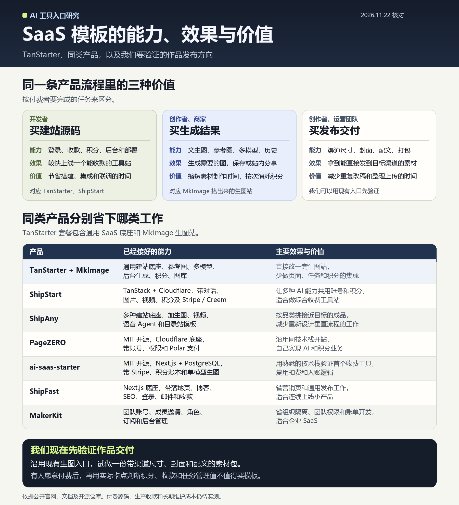

# 008 TanStarter 源码模板研究

[返回研究总库](../../README.md#项目索引) · [打开在线研究网页](https://yydshly.github.io/1123_codex_project/008-tanstarter-research/) · [查看引导图](web/assets/tanstarter-value-map.png)

- **研究入口** [Fox 的原始推广帖](https://x.com/indie_maker_fox/status/2123967409145147707) · [TanStarter 官方源码清单](https://docs.tanstarter.dev/codebase/)
- **资料基线** 2026 年 11 月 22 日核对官方文档、公开演示和开源对照仓库。付费包内两套源码均为私有仓库。
- **开源对照基线** [ai-saas-starter · d8e51dd](https://github.com/nikandr-surkov/ai-saas-starter/tree/d8e51ddb4f641995097c25dc2fc1749149149e1b)

## 模板实现了什么

| 源码 | 实现的能力 | 对开发者的价值 |
| --- | --- | --- |
| TanStarter | 通用 SaaS 底座，接好登录、权限、Stripe / Creem / Waffo 支付、管理后台、营销页、邮件和 Cloudflare 部署。另有对话、摘要、翻译、语音和生图示例。 | 搭工具站时可以复用账号、收费和运营模块，减少从空白项目开始的集成工作。 [功能清单](https://tanstarter.dev/blog/features) |
| MkImage | 基于 TanStarter 的积分生图站。用户注册、购买积分、选择模型或上传参考图，后台生成后在历史里查看作品。包含失败退积分、收藏、公开作品和提示词图库。 | 直接从已接好的生图产品流程开始改，减少页面、计费、异步任务和作品管理的开发。 [模板能力](https://tanstarter.dev/templates) · [部署文档](https://docs.tanstarter.dev/mkimage/) |

购买者拿到可修改的建站源码。实际部署使用自己的模型账号、支付商户和托管资源。对程序员，模板的价值取决于能复用多少现成流程，以及适配后能净省多少联调和维护时间。

## 对现有入口的判断

如果第一版是单模型收费生图，可以先用现有代码或免费的 [ai-saas-starter](https://github.com/nikandr-surkov/ai-saas-starter)。如果需要参考图、多模型、后台生成和作品库，MkImage 的复用价值更明确。综合图像、视频和对话的方向可以看 [ShipStart](https://shipstart.dev/)，想直接选垂直模板可以看 [ShipAny](https://shipany.ai/templates)。另外三类底座分别是 [PageZERO](https://pagezero.dev/) 的 Cloudflare 开源起点、[ShipFast](https://shipfa.st/) 的通用上线模板和 [MakerKit](https://makerkit.dev/) 的团队 SaaS。

如果重点是帮助用户发布 AI 作品，可以先用现有入口，把生成结果整理成适合目标渠道的尺寸、封面和配文，验证有人愿意为素材包付费。等收款、积分或任务管理成为实际卡点，再评估模板。

## 网页与证据范围

网页源码位于 [web/](web/)，随研究总库的 GitHub Pages 工作流发布。引导图沿用本次讨论生成的原始 PNG。免费版对照基于源码，付费包基于公开资料和演示，实际收款和长期维护成本仍待实测。
