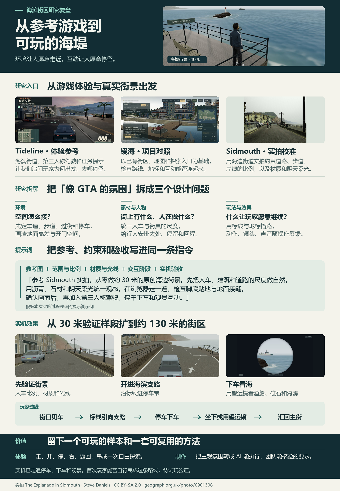

# 009 海堤街景研究

[返回研究总库](../../README.md#项目索引) · [在线研究页](https://yydshly.github.io/1123_codex_project/009-coastal-street-study/) · [在线试玩](https://yydshly.github.io/1123_codex_project/009-coastal-street-study/demo/)

- **研究入口** [《潮线失序》Tideline 公开试玩](https://dzyai.online/games/tideline/)。以浏览器试玩、界面截图和游戏内署名为观察依据。 [原版拆解与截图](reference-notes.md)
- **原库对照** [《镜海》原仓库](https://github.com/yydshly/mirror-coast-web) · [《镜海》试玩](https://yydshly.github.io/mirror-coast-web/)。用已有海滨世界、地图和探索流程检验观察能否迁移。
- **现实参照** Steve Daniels 的 Sidmouth 海滨街道实拍，用来定道路、步道、栏杆的关系和阴天柔光。 [原图](https://www.geograph.org.uk/photo/6901306) · [CC BY-SA 2.0](https://creativecommons.org/licenses/by-sa/2.0/)
- **本次实现** [原创海堤原型源码与素材署名](demo/README.md)。

## 摘要

从《潮线失序》的港城驾驶、道路引导和地点反馈出发，对照《镜海》已有的世界、地图与探索入口。我们把「像 GTA 的氛围」拆成可执行的问题。车道、步道和岸线怎样衔接，人物和素材放在哪里，以及怎样让玩家知道下一步可以做什么。先按 Sidmouth 实拍验证约 30 米街景的比例、材质和光线，再把样段扩成约 130 米的原创海堤街区。现在可从街口步行上车，沿标线进支路，停车下车后坐下看海或用望远镜观察渔船、礁石和海鸥，再汇回主街。

## 我们探索了什么

| 层面 | 参考时观察什么 | 在海堤样本里怎么验证 |
| --- | --- | --- |
| 环境 | 沿海道路、城市地标和目的地的相对位置。 | 先规划道路线形、海堤、步道和高差，再核对分岔、停车位、车门空间和人车通行。 |
| 素材与人物 | 建筑、路灯、招牌和载具如何提示地点，人物为什么会在这里出现。 | 按实拍统一尺度、材质与光照。散步行人走到观景台停留后返回。检查坡道、路缘和栏杆旁的落脚。 |
| 玩法与反馈 | 玩家从何处出发，靠什么找到目标，操作后能看到什么反馈。 | 用标线和观景台地标引路。加入驾驶重量感、车后镜头、开关门动作与声音。沿路线停车下车，再用长椅和望远镜承接停留。 |

## 提示词怎么写

写明参考图、范围与比例、材质与光线、交互阶段和实机验收。这是根据本次实施整理的可复用示例。

> 参考 Sidmouth 实拍，从零做约 30 米的原创海边街景。先定建筑、车道、步道和海堤的相对尺寸，用沥青、石材和阴天柔光统一观感。让人能在桌面浏览器里走一遍，实机检查脚贴地、坡道与路缘、材质尺度和海天接缝。画面验收后，再做第三人称驾驶、停车下车与观景。检查开门空间、镜头过渡和动作声音。交付可打开的试玩页面和对应截图。

## 实机效果与价值

已在内置浏览器完成驶入支路、停车下车、走到观景台、变焦环视和退出望远镜。修过贴边走时鞋底越界、车辆与行人穿模，以及停车时部分路缘误拦。游戏内键位显示在操作栏。建议用桌面键盘和鼠标试玩。玩家是否能仅凭现场线索走完这条路线，待首次试玩验证。

这段样本给《镜海》提供了一种可复用的做法。先选一小段可独立走通的路线，用实拍校准场景，再定义每个地点能做的动作和可看见的反馈。把这些写进提示词，就能在浏览器里逐一核对。

## 构建和部署

试玩场景位于 [demo/](demo/)，研究网页位于 [web/](web/)。根目录的 GitHub Pages 工作流先用 Node.js 22 构建试玩场景，再将研究页和试玩组装到研究总库的 009 子路径。 [完整构建命令](../../README.md#web-演示)
