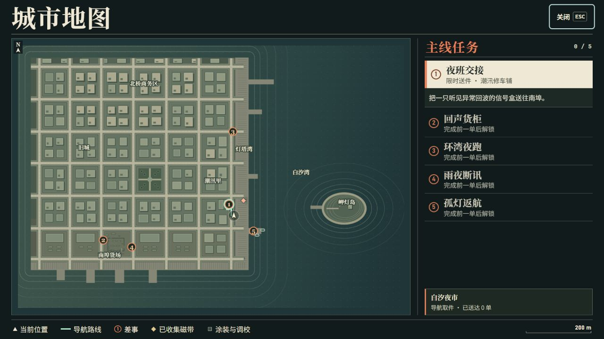

# 潮线失序环境与游戏设计研究

《GAT6 潮线失序》把同一座白汐港用于街道驾驶、仓库潜入和海上回收。它做出类似 GTA 的港城氛围，靠的是地标、交通、操控和差事同时发生在一个可到达的空间里。对《镜海》最有价值的参考，是怎样在已有的大地图里挑出少数地点，把它们做成一到现场就能理解、动手后马上有结果的玩法。

[潮线失序试玩](https://dzyai.online/games/tideline/) · [镜海试玩](https://yydshly.github.io/mirror-coast-web/)

## 环境与路线

白汐港用规则街区和沿海大道给玩家稳定的方向感。街区承担转弯、绕行和折返，海岸线提供一条容易辨认的长路线。开场把玩家和海风 GT 放在一起，第一段驾车目标是附近的修车铺。玩家因此能在学习加速、转向和减速时认识街道，而后才接受跨街区的限时差事。[首段驾驶与路面导航](evidence/05-driving.jpg)

| 空间 | 布局与可见线索 | 它如何影响操作 |
| --- | --- | --- |
| 灯塔湾海滨大道与潮汛修车铺 | 沿海直路、临街店面、招牌和车道。目标在道路旁。 | 先沿路开，再减速靠近店面。越过目标后导航能提示调头。 |
| 南埠七码仓 | 东门把露天货场接进仓库，货架分隔通道。 | 以步行接近目标，留意入口、遮挡和守卫。简报交代先在控制台切换线路，再到中继柜取录音。 |
| 灯塔湾码头、白汐湾与岬灯岛 | 出发码头、海上浮标与岛码头组成一条由近到远的水路。山体和灯塔拉开背景尺度。 | 先到泊位登艇，再驶近浮标减速打捞，随后按新目标到岛码头南侧靠泊。 |

雨后道路的反光、夜里的路灯和车灯、仓库外的雨线，以及水上的尾迹，分别强化驾驶、潜入和航行的现场感。可借鉴的布局方法是先定主通路和地标，再给每处地标一个与空间有关的操作条件，例如入口方位、停车位置、遮挡或水上接近范围。[雨夜仓库的入口与警戒界面](evidence/13-stealth.jpg) · [试航时的船速与尾迹](evidence/15-boat-wake.jpg)

## 素材与人物分工

主菜单用电台建筑、老车和晚霞定义港城的气质。接单简报延续深色底、暖色强调和大衬线标题。进入实时场景后，招牌、车辆轮廓、车灯和反光继续传递地点与时刻；常驻界面则用小面积的任务卡和仪表维持可读性。这种分工让高细节的静态插画和可操作的街景共同服务同一个场景设定。[主菜单](evidence/02-menu.jpg) · [林鹭的接单简报](evidence/08-dispatch.jpg) · [驾驶界面](evidence/05-driving.jpg)

| 素材 | 成品里的做法 | 对应的制作问题 |
| --- | --- | --- |
| 街区件与地标 | 道路、楼体、栏杆和路灯形成街景连续性。修车铺招牌、仓库门头和灯塔轮廓区分地点。 | 通用街景件负责连通，地标要在主要接近方向上能被认出来。 |
| 玩家、路人与守卫 | 第三人称主角用蓝绿色上衣和背包建立辨识度。街上有行人，仓库任务把守卫的警戒状态接到潜入界面。 | 玩家需要与操控对应的动作，路人需要活动路线，守卫需要能读懂的警戒反馈。 |
| 立绘与界面 | 林鹭的立绘出现在任务简报和电台消息中。简报讲悬念与目标，任务卡讲下一步，地图讲位置。 | 把人物叙事和操作提示分配给不同载体，让驾驶时仍能快速读到关键信息。 |
| 交互件与载具 | 仓库控制台、浮标等物件直接承担任务步骤。赤潮 RS 的游戏署名明确记录了基于 *Car Concept* 的减面、重新配色和车轮绑定。 | 为交互件准备可识别外观和状态反馈。载具还要检查部件能否独立驱动，以及跟车视角中的辨识度。 |

[游戏内模型署名](evidence/11-model-credits.jpg) · [Car Concept 原始资产](https://github.com/KhronosGroup/glTF-Sample-Assets/tree/main/Models/CarConcept)

赤潮 RS 的改编是已公开署名的制作实例。楼体、人物和插画的具体建模工具、生成方式及生产顺序仍需制作方资料确认。

## 游戏方向与继续探索的动力

成品提供主线、自由漫游和两种直达玩法的入口。主线地图列出五章，「雨夜行动」可以直达第四章，「海湾接驳」可以直达第五章。这样玩家可以先体验自己喜欢的操作方式，也可以按章节接触新的目标。地图列出夜市差事，图例标出磁带和涂装调校，给主线之外的探索留出入口。[主线与探索地图](evidence/06-map.jpg)

| 玩法 | 玩家当前的判断 | 立即能看到的反馈 |
| --- | --- | --- |
| 第一章夜班交接 | 何时转弯和减速，是否接受限时送件。 | 上车切为跟车镜头，路面箭头和转弯提示随位置更新。接受差事后出现南埠货场目标与 70 秒倒计时。 |
| 第四章雨夜断讯 | 从哪一侧进仓，什么时候切换低姿移动。 | 蹲行状态、控制台距离和守卫警戒同时显示，行进时可以判断自己是否接近目标。 |
| 第五章孤灯返航 | 怎样把船开近浮标、把速度降下来。 | 船速、航迹和距离提供操作反馈。打捞成功后，任务卡、地图和林鹭的消息共同指向岛码头。 |

第一章接单、第四章开场与低姿移动、第五章登艇与打捞均已在浏览器实玩。玩家是否愿意继续完成整章或复玩，需要观察真实的首次试玩。[打捞成功后出现新目标](evidence/16-recovery.jpg)

## 镜海可复用的设计方法

《镜海》已有公路、步行支路、水路、分区地标、多种载具和本地世界存档。「沿海一刻钟」也已串起旧城、观海、渔港清障、南湾探索和西岬航标。地图与手记能承接长期探索，开场可以用现场线索把第一段玩法讲清楚。[镜海手记实拍](evidence/mirror-coast-journal.jpg) · [镜海项目与操作说明](https://github.com/yydshly/mirror-coast-web/blob/main/README.md)

1. **从一条可走通的路线倒推环境。** 以渔港支栈桥为例，标出生点到栈桥的视线、木箱所在处、能站稳的操作位置，以及可到达的记录台。先用简单几何走通路线，再检查木箱、栏杆和木板的细节。
2. **按功能列素材。** 除了原有码头和木箱，还要核对挡路时看得出哪里不能走，清开后能看出哪里通了，记录台在接近时可辨认。这些状态决定需要哪些模型、碰撞变化和提示。
3. **让玩家的动作改变下一步。** 玩家先找到挡路的木箱，选择移除箱子并保留脚下木板，看到通路打开后走到记录台。可以让记录台给出一个附近地点的线索，观察玩家读完后是否自发继续走。

这段试玩可以记录三件事。玩家能否靠现场信息找到第一处互动，是否理解清障结果，做完后是否主动去下一站。这样能分别定位入口、操作反馈和后续目标的问题。
