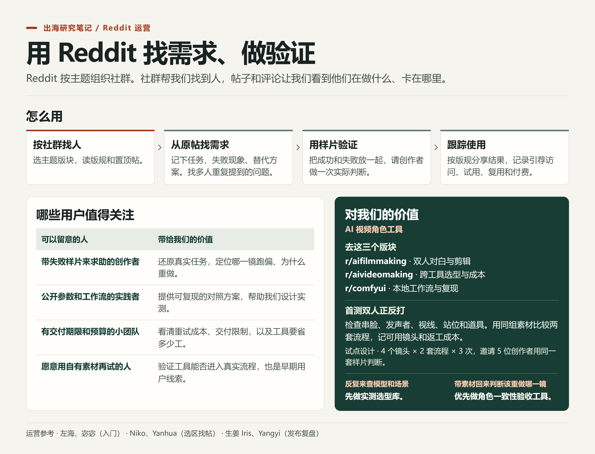

# Reddit 运营实战研究

- **编号** `010`
- **研究基线** 2026 年 11 月 22 日核对的公开资料与 Reddit 社区页面
- **在线网页** [Reddit 运营实战 · AI 视频角色工具研究](https://yydshly.github.io/1123_codex_project/010-reddit-ops-research/)
- **相关研究** [005 从 Next Token Skill 到 GEO](../005-geo-discovery-guide/README.md)

## 摘要

**内容。** 从希平的名单出发，整理 13 位中文创作者的 37 条教程、运营案例和复盘。用 AI 视频角色工具做一轮公开资料调研，核对 r/aifilmmaking、r/aivideomaking 和 r/comfyui 的公开规则及参与限制，收录 12 条需求与制作原帖。[希平原帖](https://x.com/xiping_ai/status/2124315678710620390) · [实地调研](https://yydshly.github.io/1123_codex_project/010-reddit-ops-research/#field-research)

**效果。** 网页可以按作者、主题和分享类型筛选资料，逐条查看原帖与用途。调研里反复出现五类问题，包括身份漂移、双人对白不连贯、人物或道具跳变、长镜头退化和返工成本。用一张总览图和可勾选的清单把这些发现带到下一轮测试。[原帖索引](https://yydshly.github.io/1123_codex_project/010-reddit-ops-research/#field-posts) · [验证清单](https://yydshly.github.io/1123_codex_project/010-reddit-ops-research/#field-checklist)

**价值。** Reddit 的主题社群帮助我们找到做实际项目的人。求助者暴露具体失败，公开工作流的人提供对照，有交付期限的团队说明返工代价，愿意带素材回来的人可以帮助验证复用。用这些信号决定先做实测选型库还是角色一致性验收工具，也能找到第一批愿意参与验证的用户。

## 已核对的研究结果

| 版块 | 用来找什么 | 参与边界 |
| --- | --- | --- |
| [r/aifilmmaking](https://www.reddit.com/r/aifilmmaking/) | 叙事短片、双人对白、反打和剪辑失败 | 内容指南限制商业宣传和工具演示。真实问题可按规则附上与讨论有关的测试片段。[内容指南](https://www.reddit.com/r/aifilmmaking/wiki/index/aifilmmaking_content_guidelines/) |
| [r/aivideomaking](https://www.reddit.com/r/aivideomaking/) | 跨工具选型、长镜头、积分消耗和小团队交付 | 核对时公开规则页未显示条款，Wiki 已停用。推广、外链和招募先核实具体要求。[规则页](https://www.reddit.com/r/aivideomaking/about/rules/) · [Wiki 状态](https://www.reddit.com/r/aivideomaking/wiki/index/) |
| [r/comfyui](https://www.reddit.com/r/comfyui/) | 带模型和配置的求助、可以复现的工作流 | 核对时公开规则页未显示条款。社区的求助与工作流标签用于内容分类，推广和招募先核实具体要求。[规则页](https://www.reddit.com/r/comfyui/about/rules/) |

12 条原帖可用于发现重复问题和设计对照。样本覆盖不同制作场景，产品采用、价格和需求规模还需用实际行为检验。

## 首轮怎么验证

用同一组授权角色做 4 个镜头。对照组直接使用角色参考，实验组先固定每镜首帧。每组对每个镜头跑 3 次，共 24 次生成。记录可用镜头、失败类型、生成与人工工时，并单列改一句对白需要重做的镜头数。

把成功和失败样片一起交给 5 位目标创作者，请他们实际做一次选型或重做判断。反复回来查模型和场景，优先补实测选型库。带自己的素材回来判断应该重做哪一镜，优先做镜头验收工具。这是试点设计，研究网页记录的是公开调研结果。[完整清单](https://yydshly.github.io/1123_codex_project/010-reddit-ops-research/#field-checklist)

## 本机打开网页

用浏览器打开 [web/index.html](web/index.html)。页面是静态站点，网页与原版引导图由研究库的 GitHub Pages 工作流发布。
