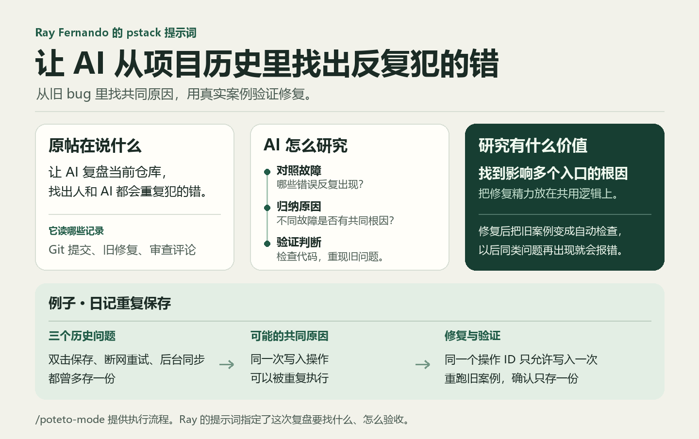

# 用 AI 复盘项目的历史 bug

- **编号** `011`
- **研究基线** 2026 年 11 月 23 日整理的公开原帖与 pstack 工作流说明
- **Web 演示** 未部署

## 摘要

**原帖在说什么。** Ray Fernando 分享了一段提示词，让 AI 复盘交给它的那个仓库。它读这个项目自己的 Git 提交、历史 bug 修复和代码审查评论，找出人和 AI 反复犯的错。`/poteto-mode` 根据任务选择工作流程。查这个仓库的历史、把重复问题变成代码约束、拿旧案例验收，是 Ray 在提示词里交代的任务。 [Ray Fernando 原帖](https://x.com/RayFernando1337/status/2124222002076733869) · [pstack 工作流](https://github.com/backnotprop/pstack/blob/main/skills/poteto-mode/SKILL.md#playbooks)

**AI 怎么研究。** 把几次故障的触发条件、实际结果和修复位置放在一起对照，找出可能的共同原因，再通过代码和复现验证。分析结果应能指出哪些问题反复发生、判断依据对应哪些提交或审查记录，以及哪一处修复可能覆盖多个入口。具备复现条件时，用同样的步骤对照旧版和修复版的结果。 [pstack 的 bug 修复流程](https://github.com/backnotprop/pstack/blob/main/skills/poteto-mode/playbooks/bug-fix.md)

**研究有什么价值。** 把零散的修复记录整理成有证据的修复优先级。确认共同原因后，优先在代码结构或类型上消除出错条件，再考虑静态检查或回归测试。对确实发生过的并发、重试和状态机错误，可以把模型检查接入 CI。让新增的检查先抓住一个历史错误，之后每次改动都可以用它检查旧问题是否重现。 [Ray Fernando 原帖](https://x.com/RayFernando1337/status/2124222002076733869)

## 示例 · 日记重复保存

假设某个日记应用先后出现过三种症状。双击保存、断网后重试、后台同步，都会让同一篇日记多存一份。如果代码和复现表明三种情况都能重复执行同一次写入，就可以给每次写入分配一个操作 ID，并在共用的写入逻辑里保证同一个操作 ID 只写入一次。

用同一套步骤重跑旧案例。旧版会留下两份，修复版应只留一份。把这个检查留在项目里，后续改动一旦让同一操作再次写入两份，测试就会失败。这是说明方法的假设案例。
