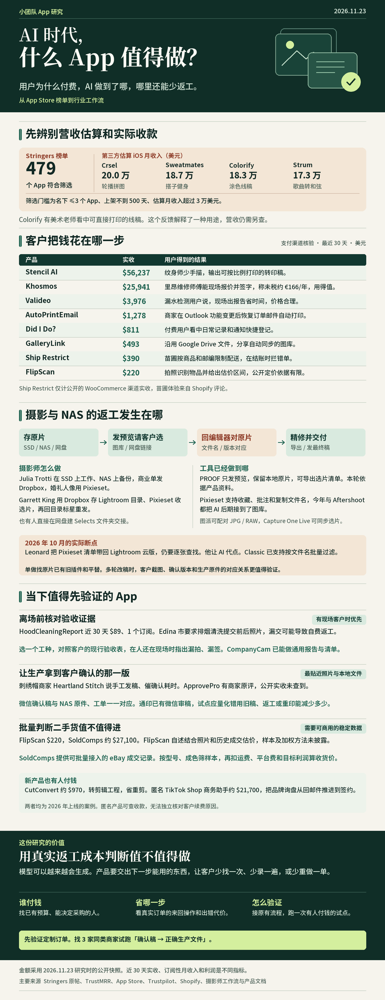

# AI 时代值得做的小团队 App

- **编号** `013`
- **研究基线** 2026 年 11 月 23 日整理的公开营收快照、客户原评、从业者工作流和产品文档
- **Web 演示** 未部署

## 摘要

**从榜单进到真实订单。** Stringers 从开发者名下不超过 3 个应用、上架不到 500 天、估算月收入超过 3 万美元的条件里筛出 479 个 App。Crsel、Sweatmates、Colorify 和 Strum 提供了选题线索。客户为什么付费，需要回到支付渠道和客户原话。Khosmos 的维修客户明确说现场报价、签字足以收回订阅成本。Stencil AI 把设计稿变成纹身师能按比例打印的转印稿，缩短每次开工前的手描时间。 [Stringers 原帖](https://x.com/stringers_cn/status/2124382376310775887) · [Khosmos 用户原评](https://apps.apple.com/fr/app/khosmos-devis-facturation/id6449428730) · [Stencil AI 实收](https://trustmrr.com/startup/stencil-ai)

**摄影流程里的卡点。** 摄影师已经在用 SSD、NAS 和网盘存原片，用 Pixieset 或网盘让客户选图，再回 Lightroom 对文件名、标记原片。PROOF 的公开资料显示它可只发预览并导出选片清单，本轮未实测。到 2026 年，Pixieset 和 Aftershoot 已把 AI 后期接进图库，图派也能关联 JPG 和 RAW。Adobe 社区仍有用户要在 Lightroom 云版逐张查找 Pixieset 选片，Classic 已有批量过滤。单做找原片的优先级较低。更值得观察的是多轮改稿中客户确认的预览如何与最终生产原件对应。 [Julia Trotti 的备份工作流](https://juliatrotti.com/blogs/photography/photography-backup-workflow) · [Garrett King 的后期流程](https://rangefinder.substack.com/p/from-chaos-to-order-building-a-bulletproof) · [Pixieset 选片](https://help.pixieset.com/hc/en-us/articles/115003797011-Pixieset-and-Proofing) · [Pixieset Photo Editor](https://website-help.pixieset.com/en/articles/14063290-getting-started-with-pixieset-photo-editor) · [Aftershoot 图库](https://support.aftershoot.com/en/articles/14699040-gallery-analytics) · [图派](https://www.picsect.com/) · [Adobe 社区原帖](https://community.adobe.com/questions-680/need-to-filter-all-photos-with-specific-filenames-based-on-client-picks-1651692)

**我们怎么判断价值。** 能把某一步接进已有工作流，并交出下一步直接能用的结果，才容易算清省下的时间、返工费用或成交机会。就照片、作品和本地存储而言，先验证定制商家的「客户确认稿 → 生产文件」交接。找三家同类商家复盘真实的错版或重印订单，接入它们正在用的微信、共享盘和工单，跑一轮付费试点。用找稿时间、催确认次数、错版或重印情况来判断是否值得继续。国内这一步的独立付费意愿尚未验证。 [定制商家原评](https://apps.shopify.com/approvepro/reviews) · [国内已有的微信审稿](https://www.itongyin.com/)

## 实收与客户用途

金额为研究当日 TrustMRR 显示的最近 30 天收入，单位为美元。可查的金额取决于产品接入的支付渠道。客户体验来自公开评论或产品资料，个别评论者的支付记录通常无从核对。 [TrustMRR 核验口径](https://trustmrr.com/faq)

| 产品 | 近 30 天实收 | 客户用它完成什么 |
| --- | ---: | --- |
| Stencil AI | $56,237 | 输出可打印的纹身转印稿，少花时间手描。 [实收](https://trustmrr.com/startup/stencil-ai) |
| Khosmos | $25,941 | 上门维修时在手机上报价并让客户签字。里昂一位维修师傅说未税约 €166/年用得值。 [实收](https://trustmrr.com/startup/khosmos) · [用户原评](https://apps.apple.com/fr/app/khosmos-devis-facturation/id6449428730) |
| Valideo | $3,976 | 在漏水检测现场汇总照片、记录和签字，当场出报告。 [实收](https://trustmrr.com/startup/valideo) · [用户原评](https://apps.apple.com/fr/app/valideo/id6749849456) |
| AutoPrintEmail | $1,278 | Outlook 功能变更后，商家恢复收到订单邮件就自动打印的流程。 [实收](https://trustmrr.com/startup/autoprintemail) · [用户原评](https://www.trustpilot.com/review/autoprint.email) |
| Did I Do? | $811 | 付费用户谈的是日常记录和通知快捷登记。锁门是厂商举的用途之一。 [实收及应用入口](https://trustmrr.com/startup/did-i-do) |
| GalleryLink | $493 | 把现有 Google Drive 文件夹发成可同步的展示图库，减少重复上传。 [实收](https://trustmrr.com/startup/gallerylink) |
| Ship Restrict | $390 | 苗圃按商品和邮编拦截无法配送的订单。实收统计 WooCommerce 渠道，苗圃反馈来自 Shopify。 [实收](https://trustmrr.com/startup/ship-restrict) |
| FlipScan | $220 | 据厂商介绍，先看照片识别商品，再结合历史成交估出区间。来源、样本筛选和加权方式未公开。美区订阅为 $14.99/月或 $49.99/年，未找到定价推导。 [实收及订阅价格](https://trustmrr.com/startup/flipscan) · [产品说明](https://flipscan.app/) |

## 现在值得验证什么

| 方向 | 可查的信号 | 验证时看什么 |
| --- | --- | --- |
| 离场前查漏拍、漏签 | 2026 年成立的 HoodCleaningReport 将 CompanyCam 照片转成清洗报告，近 30 天 $89，有 1 个活跃订阅。Edina 市的排烟清洗许可文件显示，未按要求提交报告和照片可能产生自费重洗与复检。 [实收](https://trustmrr.com/startup/hoodcleaningreport) · [验收文件](https://www.edinamn.gov/DocumentCenter/View/4263/Commercial-Kitchen-Exhaust-Hood-and-Duct-System-Inspection--Cleaning-Permit-PDF) | 用某个客户现行的验收表，验证能否在人离场前补齐特定照片和签字。CompanyCam 已覆盖通用 AI 报告和清单。 [现有能力](https://companycam.com/resources/user-guides/ai) |
| 把确认稿准确交给生产 | 刺绣帽商家 Heartland Stitch 说手工发稿、催确认消耗大量时间。ApprovePro 未查到公开实收。相邻场景的 CutConvert 近 30 天约 $970，它转换可继续编辑的剪辑工程，省去在另一个编辑器重剪。 [商家原评](https://apps.shopify.com/approvepro/reviews) · [CutConvert 实收](https://trustmrr.com/startup/cut-convert) | 验证微信确认与 NAS 上的原件、工单能否一一对应，修改后是否需要重新确认。用工时与重印记录衡量价值。 |
| 批量判断二手货的进货价 | SoldComps 近 30 天约 $27,100。它把 eBay 可回查的成交价、成色、日期和运费提供给需要批量处理的用户。 [实收](https://trustmrr.com/startup/soldcomps) · [数据字段](https://sold-comps.com/) | 确保数据来源稳定且允许商用。用同型号、同成色的成交记录估算售价，再按运费、手续费和目标利润倒推出最高收购价。eBay 官方成交数据接口限制新用户接入。 [eBay 接入说明](https://www.developer.ebay.com/api-docs/buy/static/ref-buy-browse-filters.html) |

AI 也能直接承担业务环节。2026 年 8 月上线的一人产品，把 TikTok Shop 创作者的品牌询盘从回信、回价跟进到签约，近 30 天 Stripe 约 $21,700。匿名页面可查收款，创始人披露的成交额和客户续费动机缺少独立验证。这个案例说明可以按业务结果去寻找付费点。 [匿名产品实收与定价](https://trustmrr.com/startup/confidential-startup-61)
