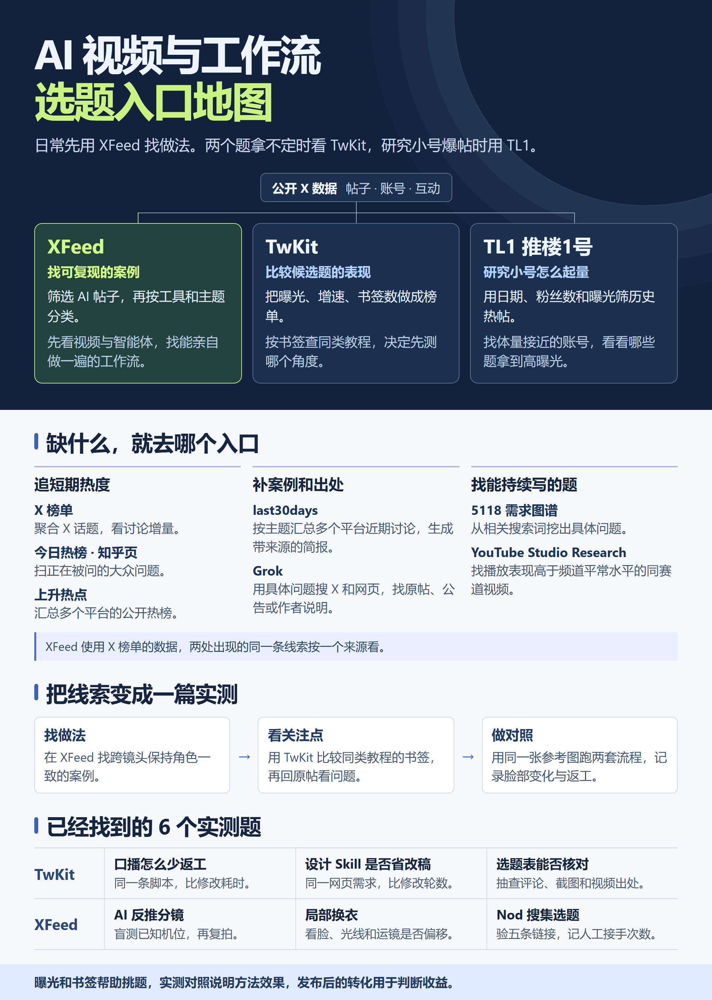

# 015 AI 视频与工作流选题指南

[返回研究总库](../../README.md#项目索引) · [打开在线指南](https://yydshly.github.io/1123_codex_project/015-ai-topic-source-guide/) · [查看六个实测选题](https://yydshly.github.io/1123_codex_project/015-ai-topic-source-guide/#topics)

## 引导图

## 摘要

- **能力**。对照 10 个入口如何精选内容、按互动排序、筛历史样本、检索原文和挖搜索需求。日常用 XFeed 找做法，题目难取舍时用 TwKit，看小号爆帖时用 TL1。
- **效果**。网页用一张图展示入口之间的关系，并把 TwKit、XFeed 各 3 条线索改写成可测试的选题。每题留有原帖或发布页、测试步骤和要记录的指标。
- **价值**。让创作者拿着一个具体问题去查案例和数据，再用相同素材和条件做对照，减少在泛资讯里来回翻找，为下一篇内容保留可复用的出处与验证步骤。

## 我们的理解

| 要做的判断 | 入口 | 看什么 |
| --- | --- | --- |
| 有哪些做法可以亲自复现 | XFeed | 按 AI 工具和题材归类的案例、教程和原帖。 |
| 哪些同类教程受到关注 | TwKit | 近期长文的书签、曝光，以及短帖的传播速度。 |
| 同体量小号用什么角度起量 | TL1 | 用粉丝上限和日期筛出的历史热帖。 |
| 一个话题有没有扩散 | X 榜单、今日热榜知乎页、上升热点 | 话题讨论增量，以及不同平台的公开榜单。 |
| 能不能补齐原始证据 | last30days、Grok | 按具体问题找同期案例和来源链接，回原帖核对关键说法。 |
| 哪些问题值得做成长期教程 | 5118 需求图谱、YouTube Studio Research | 具体搜索词，以及高于其频道平常表现的同类视频。 |

XFeed 使用 X 榜单的数据。同一条线索在两个入口出现时按一个来源计。书签和曝光适合参考读者关注，实测效果取决于对照结果，收益以发布后的转化记录判断。

## 首轮选题与验证记录

| 发现入口 | 选题 | 准备记录的结果 |
| --- | --- | --- |
| TwKit | 20 秒口播一键生成与分步骤出片 | 同时改台词与字幕，比较修改耗时、重做步骤和费用。 |
| TwKit | 用设计 Skill 帮 Codex 交付网页 | 给同一模型同一份需求，记录移动端布局问题、改稿轮数与耗时。 |
| TwKit | 从评论、截图与视频生成可核对的选题表 | 按原评论、截图位置和时间码逐条核对，记录可追溯条数和人工核对时间。 |
| XFeed | 视频反推可复拍分镜 | 用三段已知拍法的素材盲测，挑一段按结果复拍或重建。 |
| XFeed | 视频局部换衣 | 用同段素材比对脸、光线、背景与运镜，记录重试次数。 |
| XFeed | Nod 在 Windows 上搜集选题 | 给三个公开页面找五条线索，检查链接、完成条数、接手次数和耗时。 |

这次完成的是入口研究、题目选择与实验设计，表格记录的是下一轮要测的指标。TwKit 书签数采用 2026 年 11 月 23 日查阅的榜单快照。Miracle 的方案按已能使用的工具先做对照，获得厂商测试权限后可用同样的素材补测。

## 本机与线上

直接打开 [web/index.html](web/index.html) 可阅读正文及原版 PNG，访问来源链接时需要联网。线上版由研究总库的 GitHub Pages 工作流部署，入口位于 [015-ai-topic-source-guide](https://yydshly.github.io/1123_codex_project/015-ai-topic-source-guide/)。
